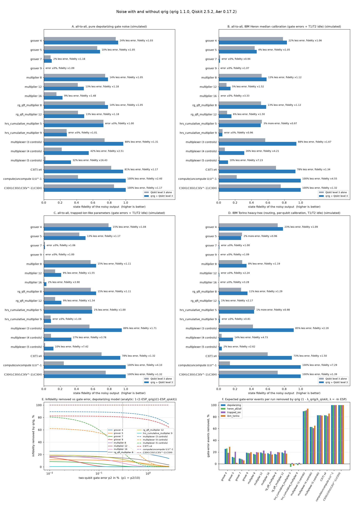
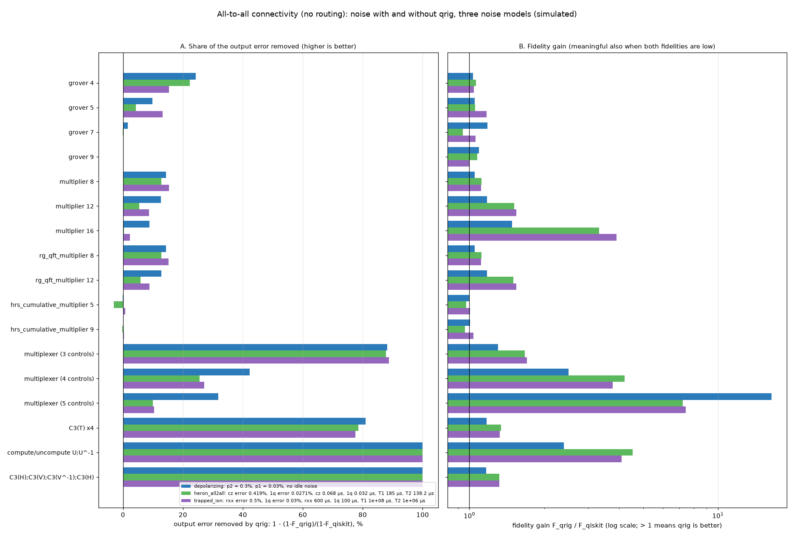

# How much noise does qrig remove?



Full tables: [`noise_results.md`](noise_results.md). Raw data: [`noise_results.json`](noise_results.json).
Script: [`noise_benchmark.py`](noise_benchmark.py).

We remove controlled gates to reduce the effect of noise. This benchmark measures that
effect directly. We take the circuits where qrig reduces the gate count, compile each one
twice, simulate both versions under noise, and compare how close each noisy output is to
the exact output:

* **Qiskit alone**: Qiskit 2.5.2's level-3 preset pass manager (its strongest preset).
* **qrig + Qiskit**: qrig's verified DAG pass `QrigControlEquations` first, then the
  *same* level-3 pass manager.

Everything is a **simulation** with Qiskit Aer 0.17.2. No real hardware was used.

## Short answer

With depolarizing noise at today's error rates (0.3 % per two-qubit gate, 0.03 % per
one-qubit gate) and all-to-all connectivity:

| circuits | CX removed by qrig | error removed (1 − F) | fidelity F: Qiskit → qrig |
|---|---|---|---|
| Grover 4 / 5 qubits (MQT Bench) | 27 % / 11 % | **24 % / 10 %** | 0.877 → 0.907 / 0.653 → 0.687 |
| multipliers 8 / 12 qubits (MQT Bench `multiplier`, `rg_qft_multiplier`) | 17 % / 19 % | **14 % / 13 %** | 0.748 → 0.784 / 0.416 → 0.490 |
| multiplier 16 qubits | 18 % | **9 %** | 0.155 → 0.229 (×1.48) |
| multiplexers, 3 / 4 / 5 controls | 90 % / 63 % / 83 % | **88 % / 42 % / 32 %** | 0.74 → 0.97 / 0.22 → 0.55 / 0.02 → 0.33 (×16) |
| four repeated C³(T) gates | 82 % | **81 %** | 0.824 → 0.966 |
| compute/uncompute, C³H·C³V·C³V†·C³H | 100 % | **100 %** | 0.42 → 1 / 0.86 → 1 |

Rules of thumb that the data supports:

1. **When the fidelity is still high, qrig removes about the same share of the error as
   it removes of the gates.** Panel C shows this: at low error rates each curve levels off
   at the share of (error-weighted) gates removed. Panel D shows the same thing without
   simulation. The expected number of gate errors per run, λ = −ln ESP, falls by
   9–25 % on the MQT circuits and by 63–100 % on the structured circuits. That matches
   the CX savings.
2. **When the fidelity is low, look at the fidelity ratio instead.** In a deep circuit
   both versions lose most of their fidelity, so "error removed" shrinks towards 0. The
   ratio `F_qrig / F_qiskit` keeps growing: ×1.18 for Grover 7, ×1.48 for multiplier 16,
   ×16 for the 5-control multiplexer. When noise scales a measured signal by F, the
   number of shots needed for a given precision grows roughly like 1/F². A fidelity
   ratio of ×1.5 therefore means roughly 2.2× fewer shots.
3. **When qrig does not reduce the CX count, there is nothing to gain.** Under the
   `{cx, rz, sx, x}` basis, `hrs_cumulative_multiplier` gets no CX saving (122 → 122,
   484 → 482), so its fidelity is unchanged. It is included as a control.

## On a realistic device model (IBM Torino calibration)

The second noise model uses the calibration snapshot of the 133-qubit IBM Heron device
`FakeTorino` from `qiskit-ibm-runtime`. This model includes:

* the heavy-hex coupling map, so Qiskit inserts SWAPs;
* the native CZ gate;
* per-qubit and per-pair gate errors and durations;
* T1/T2 relaxation while qubits sit idle (the circuit is scheduled as late as possible,
  and each idle gap becomes a thermal-relaxation channel).

| circuit | CZ Qiskit → qrig | error removed | fidelity Qiskit → qrig |
|---|---|---|---|
| Grover 4 | 79 → 54 | **23 %** | 0.719 → 0.783 |
| multiplier 8 / rg_qft_multiplier 8 | 229 → 172 | **8 % / 11 %** | 0.286 → 0.340 / 0.272 → 0.351 |
| multiplier 12 / rg_qft_multiplier 12 | 740 → 594 | < 1 % (both near 0) | 0.0033 → 0.0073 (×2.2) / 0.0046 → 0.0099 (×2.2) |
| multiplexer 3 / 4 controls | 221 → 15 / 1059 → 371 | **85 % / 14 %** | 0.42 → 0.91 / 0.037 → 0.174 (×4.7) |
| four repeated C³(T) gates | 129 → 18 | **73 %** | 0.597 → 0.893 |
| compute/uncompute | 517 → 0 | **100 %** | 0.137 → 1 |
| **Grover 5** | 262 → 242 | **−2 % (worse)** | 0.285 → 0.273 |
| hrs_cumulative_multiplier 5 / 9 | 166 → 170 / 672 → 678 | −1 % / −0.3 % | 0.440 → 0.433 / 0.017 → 0.014 |

On real hardware the gain depends on more than the gate count:

* **Grover 5 got slightly worse.** qrig saved 8 % of the CZ gates, but gate errors
  alone predict only a 1.5 % higher success probability (ESP 0.405 → 0.411). The compiled
  qrig circuit was also scheduled about 1.3 µs longer (30.4 µs against 29.1 µs) on
  different physical qubits. Idle decoherence cancelled the small gain.
* **The hrs multipliers got slightly worse.** qrig makes no real change to them, and
  routing then gave 4–6 more CZ gates, which is ordinary compiler variance.
* **Deep circuits are dominated by idle decoherence.** No dynamical decoupling is
  simulated, so at 12 qubits or more both versions are close to fully decohered. In those
  cases only the fidelity ratio (×2.2–3.3) is informative.

## All-to-all connectivity (no topology bias)



On heavy-hex hardware part of the result depends on routing: SWAP insertion and qubit
placement can hide or add to qrig's saving. To measure qrig's effect without that, two
more models with **all-to-all connectivity** are simulated. Qiskit never inserts a SWAP
in them, so both versions differ only in the gates qrig removed.

* `heron_all2all`: IBM Heron physics without the heavy-hex layout. An all-to-all CZ
  target using the *median* FakeTorino calibration on every qubit/pair: CZ error
  0.419 %, 1q error 0.0271 %, CZ 68 ns, 1q 32 ns, T1 185 µs, T2 138 µs. Idle
  relaxation is included as for `ibm_torino`. This isolates the effect of topology:
  same physics as `ibm_torino`, different connectivity.
* `trapped_ion`: an all-to-all trapped-ion-like device (as in IonQ or Quantinuum
  systems), native gates `{rxx, rz, sx, x}`: RXX (Mølmer–Sørensen) error 0.5 %, 1q error
  0.03 %, RXX 600 µs, 1q 100 µs, T1 100 s, T2 1 s, idle relaxation included.
  **These are assumed round numbers, not a vendor calibration.** Change them with
  `--ion-p2 --ion-p1 --ion-d2 --ion-d1 --ion-t1 --ion-t2` (durations and T1/T2 in seconds).

| circuit | 2q gates Qiskit → qrig (Heron a2a / ion) | error removed, Heron a2a | F Heron a2a | error removed, ion | F ion |
|---|---|---|---|---|---|
| Grover 4 | 52 → 38 / 44 → 36 | **22 %** | 0.784 → 0.832 | **15 %** | 0.790 → 0.822 |
| Grover 5 | 168 → 150 / 150 → 120 | **4 %** | 0.439 → 0.463 | **13 %** | 0.434 → 0.509 (×1.17) |
| Grover 7 | 1092 → 996 / 990 → 918 | ≈ 0 (both near 0) | 0.0162 → 0.0153 (×0.94) | ≈ 0 (both scrambled) | 0.0144 → 0.0153 |
| multiplier 8 / rg_qft 8 | 115 → 96 / 91 → 72 | **13 %** | 0.52 → 0.58 (×1.12) | **15 %** | 0.57 → 0.64 (×1.11) |
| multiplier 12 / rg_qft 12 | 340 → 276 / 274 → 210 | **5–6 %** | 0.095 → 0.144 (×1.5) | **9 %** | 0.138 → 0.213 (×1.55) |
| multiplier 16 | 719 → 592 / 583 → 456 | < 1 % (both near 0) | 0.0013 → 0.0043 (×3.3) | **2 %** | 0.008 → 0.032 (×3.9) |
| multiplexer 3 / 4 / 5 controls | 122 → 12 / 624 → 232 / 2626 → 452 | **88 % / 26 % / 10 %** | ×1.67 / ×4.2 / ×7.2 | **89 % / 27 % / 10 %** | ×1.71 / ×3.8 / ×7.4 |
| four repeated C³(T) gates | 80 → 14 / 68 → 13 | **79 %** | 0.698 → 0.935 | **78 %** | 0.705 → 0.934 |
| compute/uncompute, C³H·C³V·C³V†·C³H | → 0 | **100 %** | 0.22 → 1 / 0.76 → 1 | **100 %** | 0.24 → 1 / 0.76 → 1 |
| hrs_cumulative_multiplier 5 / 9 (control) | 122 → 128 / 484 → 494 | −3 % / −0.2 % | 0.527 → 0.513 | +0.7 % / +0.4 % | 0.588 → 0.591 |

What changes without the topology:

* **Grover 5 is no longer worse.** On `ibm_torino` it lost 2 %; with the same physics
  but all-to-all connectivity qrig removes 4 % of the error, and on the ion model 13 %.
  The regression on Torino came from placement and routing, not from qrig.
* **Half the two-qubit gates disappear for both versions.** Without SWAPs, multiplier 8
  needs 115 CZ instead of 229, so absolute fidelities are much higher (multiplier 12:
  0.095 → 0.144 all-to-all against 0.0033 → 0.0073 on Torino). Because the circuits stay
  in the useful fidelity range for longer, "error removed" is larger for the 8–12-qubit
  circuits than on Torino (13 % against 8–11 % at 8 qubits; 5–9 % against < 1 % at 12).
* **The two all-to-all models agree closely** even though their gate sets and time
  scales differ by four orders of magnitude, so the saving comes from the removed gates,
  not from details of one platform. The ion model benefits slightly more because its
  RXX basis lets Qiskit merge more of the remaining gates (e.g. Grover 5: 20 % fewer
  RXX gates against 11 % fewer CZ).
* **Grover 7 on `heron_all2all`** is the one case where qrig comes out marginally lower
  (F 0.0162 → 0.0153). Both outputs are almost fully decohered there (F is close to
  the 1/2⁷ of a random state), so the difference is not meaningful.
* **The control (`hrs_cumulative_multiplier`) stays flat**, within ±3 %, as expected
  when qrig removes nothing.

## Method

* **Circuits.** Two sources:
  * MQT Bench circuits at the algorithmic level where qrig reduced the CX count in
    [`mqt_results.md`](mqt_results.md): `grover` 4–9, `multiplier` 8–16,
    `rg_qft_multiplier` 8–12, plus `hrs_cumulative_multiplier` as a control.
    `grover 11` is available with `--scale`.
  * The structured circuits from `benchmark.py`: multiplexers, repeated C³(T), a
    random compute/uncompute pair, and C³H·C³V·C³V†·C³H.
* **Compilation.** Both versions use `qubits_initially_zero=False`, so they are compiled
  as unitaries. For each version, five transpiler seeds are tried and the result with
  the highest estimated success probability is kept, as you would do in practice.
* **Noise models.**
  * `depolarizing`: depolarizing error after every gate, with `p2` for CX and
    `p2/10` for `sx`/`x`; `rz` is error-free (virtual). Set `p2` with `--p2`.
  * `ibm_torino`: the gate errors are Qiskit Aer's `basic_device_gate_errors`
    (depolarizing plus thermal relaxation over each gate's duration). On top of that,
    each idle period becomes an explicit `thermal_relaxation_error(T1, T2, t)`.
    Readout error is left out; it affects both versions equally.
  * `heron_all2all` and `trapped_ion`: all-to-all targets with uniform gate errors and
    durations (values above); gate errors are depolarizing plus thermal relaxation
    over the gate duration, idle periods get `thermal_relaxation_error` as for
    `ibm_torino`. The RXX error is taken as independent of the rotation angle.
  * Choose models with `--models` (default: all four).
* **Metrics.**
  * `F` is the state fidelity ⟨ψ_ideal|ρ_noisy|ψ_ideal⟩, averaged over 3 random product
    input states. The inputs are prepared without noise and placed on the physical
    qubits according to each version's layout.
  * `P` is the Hellinger fidelity between the noisy and ideal output distributions for
    one classical input: |0…0⟩ for Grover, a random basis state otherwise. When the
    correct output is a single basis state, `P` is the probability of reading it.
  * ESP is ∏(1 − e_g) over all gates.
  * "Error removed" is `1 − (1−F_qrig)/(1−F_qiskit)`.
* **Simulator.** Density matrices, which are exact, up to 12 active qubits. Above that,
  300 quantum trajectories are used, and the tables give their standard error.
* **Checks.** For every case and model, the script checks that the noiseless output
  distributions of both compiled versions agree with each other. Up to 12 qubits it also
  checks them against Qiskit's `Statevector` of the original benchmark. If any check
  fails, the script stops. `tests/test_noise.py` covers three more things:
  * the zero-noise limit gives F = 1;
  * trajectories agree with the density-matrix result;
  * qrig improves fidelity on the repeated C³(T) case.

## Caveats

* These are simulations with four noise models; the trapped-ion parameters are assumed,
  not measured. Real devices also have crosstalk,
  leakage and drift, and usually use dynamical decoupling. The absolute fidelities will
  differ on hardware; the direction of the effect should not.
* The structured circuits were chosen because they contain the patterns qrig targets.
  They show what is possible for such circuits, not how common such circuits are.
* On a real device, qubit placement and scheduling can outweigh a small gate saving
  (Grover 5 above). In practice, compile both ways and keep the version with the
  higher estimated fidelity.
* The random inputs, seeds and results are from a single run (`seed = 20260929`) on one
  machine.

## How to run

```bash
pip install qiskit qiskit-aer qiskit-ibm-runtime mqt.bench matplotlib   # or: pip install ".[noise]"
cd python
python3 benchmarks/noise_benchmark.py            # full suite, all 4 models, about 75 minutes on 8 cores
python3 benchmarks/noise_benchmark.py --models heron_all2all trapped_ion   # all-to-all only
python3 benchmarks/noise_benchmark.py --models trapped_ion --ion-p2 2e-3   # other ion error rate
python3 benchmarks/noise_benchmark.py --quick    # about 1 minute
python3 benchmarks/noise_benchmark.py --p2 1e-3 --models depolarizing   # other error rate
python3 benchmarks/noise_benchmark.py --resume   # continue an interrupted run
python3 benchmarks/noise_benchmark.py --replot   # redraw plot/tables from the JSON
python3 -m pytest -q tests/test_noise.py
```
