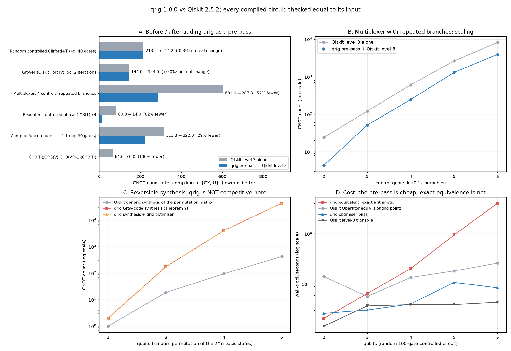

> **Consolidated results (start here):** every result — all-to-all noise study on 130
> circuits, resources, time, fault-tolerant cost, robustness, and comparison with TKET
> and BQSKit — is collected in [`report/qrig_results.pdf`](../../report/qrig_results.pdf)
> (Markdown version for tools/LLMs: [`report/qrig_results.md`](../../report/qrig_results.md)).
> Scripts: `paper_study.py` (main study), `compilers_study.py` (TKET/BQSKit),
> `app_circuits.py` (application kernels), `make_report.py` (builds the report).
>
> **Noise:** how much noise qrig removes (noisy simulation; depolarizing, all-to-all Heron,
> trapped-ion-like and IBM Torino noise models) is in [`NOISE.md`](NOISE.md).
>
> **MQT pipeline:** for the MQT Bench → Qiskit DAG → qrig → MQT QCEC testing pipeline
> (DAG-level control-equation pass, rule statistics, equivalence checking), see
> [`MQT_PIPELINE.md`](MQT_PIPELINE.md).

# Does qrig improve on the conventional Qiskit workflow?

Regenerate the plot with `cd python && python3 benchmarks/benchmark.py` (about 1–2 minutes;
needs `qiskit` and `matplotlib`). Exact numbers are in [`results.md`](results.md) and
[`results.json`](results.json).

## Is "before vs after" the right question?

Partly. The paper *One rig to control them all* is not an optimisation paper. It gives
a complete set of equations, (a)–(h), for controlled circuits, and qrig implements
those equations with proofs. A gate-count benchmark measures only one use of that
theory: using the equations as rewrite rules. Other things qrig gives you (exact
equivalence checking with no floating-point tolerance, and optimisation passes whose
soundness is proved in Lean) are guarantees, not speed-ups, so a plot cannot show them.
They are still fair to measure, so panel D shows their cost.

The fair version of the question is **"what happens if I add qrig as a pre-pass to my
existing Qiskit pipeline?"** That is what panels A and B show:

* **Before**: Qiskit's preset level-3 pass manager (the strongest preset), targeting
  `{cx, u}`.
* **After**: the same pass manager with `qrig.qiskit_bridge.QrigOptimize` inserted at
  the front (the `pre_init` stage). qrig rewrites the high-level circuit, and Qiskit
  does all its usual work afterwards.

qrig has to run first. After Qiskit compiles to `{cx, u}`, the circuit contains
continuous `u` angles and has lost its controlled-gate structure, so qrig has nothing
to work with.

## What the results say

| workload | CX: Qiskit alone → with qrig pre-pass |
|---|---|
| random controlled Clifford+T circuits | 213.6 → 214.2 (no real change) |
| Grover (Qiskit's library construction) | 144 → 144 (no change) |
| multiplexer with repeated branches (4 controls) | 602 → 288 (−52 %) |
| repeated multi-controlled phases, `C³(T)⁴` | 80 → 14 (−82 %) |
| compute/uncompute `U; U⁻¹` | 314 → 223 (−29 %) |
| `C³(H) C³(V) C³(V†) C³(H)` | 64 → 0 (−100 %) |

* **Where it helps:** circuits built from multi-controlled gates whose neighbours can
  be merged by the control equations. Examples: `C⁰(f);C¹(f) = id+f` (equation e),
  `C(f);C(g) = C(f;g)` (equation a), and cancelling a multi-controlled gate against its
  inverse. Qiskit 2.5.2 at level 3 does **not** do these merges. It breaks multi-controlled
  gates into CX+U first, and after that its local optimisers can no longer see the
  structure. For example, two consecutive Toffoli gates still compile to 12 CNOTs. The
  savings grow with the number of controls (panel B). Circuits like these show up in
  state preparation (multiplexers), oracles and uncomputation.
* **Where it does nothing:** unstructured circuits and circuits that are already tidy
  (Grover). qrig's rewrites are local and only look at neighbouring gates. On random
  circuits the pre-pass is neutral on average; for individual circuits it can be a
  few CX better or worse, because Qiskit's heuristics see a different input.
* **Where it is worse:** permutation synthesis (panel C). qrig's Gray-code synthesis
  follows Theorem 9 of the paper. It is a constructive proof that every permutation can
  be built from controlled NOTs, not an efficient synthesis method. It needs 10–100×
  more CNOTs than Qiskit's generic unitary synthesis. Use `synthesize_permutation` when
  you want a correct-by-construction NOT/CNOT/Toffoli circuit, not a small one.
* **Cost (panel D):** the qrig pre-pass costs the same order of time as Qiskit's own transpile (up to about 2–3×)
  (about 0.1 s or less on these sizes). Exact equivalence checking computes the full unitary
  with exact arithmetic in Q(ω), so it grows about 4× per qubit. It is about 15×
  slower than Qiskit's floating-point `Operator.equiv` at 6 qubits. That is the
  price of an exact answer.

**In short:** use qrig as a pre-pass when your circuits contain structured
multi-controlled gates. It is cheap, and the optimised circuit comes with a proof that
it implements the same unitary. It will not make generic circuits smaller, and its
permutation synthesis is not meant to compete on gate count.

## Method and fairness notes

* Every compiled circuit, both before and after, is checked equal to the original with
  Qiskit's `Operator` before its gates are counted. This is exact equality, not
  equality up to phase, and it accounts for any final qubit permutation that Qiskit
  records.
* Both pipelines use `qubits_initially_zero=False`, so circuits are compiled as
  unitaries (reusable subroutines). With Qiskit's default (`True`), Qiskit may use idle
  qubits as clean ancillas. The result is then only correct when those qubits start in
  |0⟩, so it cannot be checked as a unitary. We found this while writing the benchmark:
  it is Qiskit's documented behaviour, not a bug in either tool.
* Counts are CNOTs after compiling to `{cx, u}` with no coupling map, so there is no
  routing. Values are means over 1–10 random instances (fixed seed `20260925`). Timings
  are from one run on one machine and depend on the hardware.
* The workloads in rows 3–6 were chosen to contain the patterns the control equations
  target. They show *what kind* of circuit benefits, not how common such circuits are.
  Rows 1–2 are the unstructured and library controls.
* A Qiskit expert could get some of these savings by hand, for example by writing a
  multiplexer as `UCGate` or adding custom cancellation passes. The comparison is
  against Qiskit's standard level-3 pipeline.
