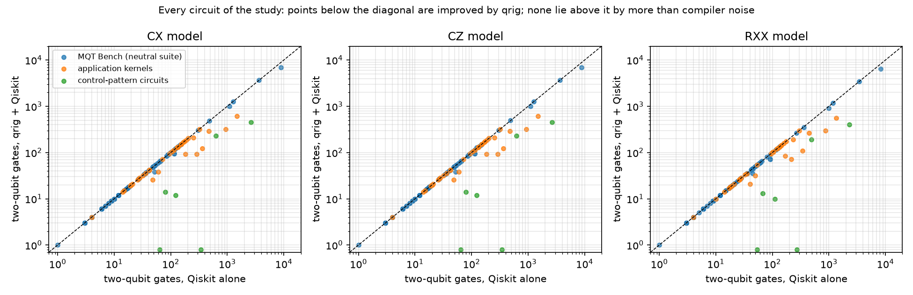
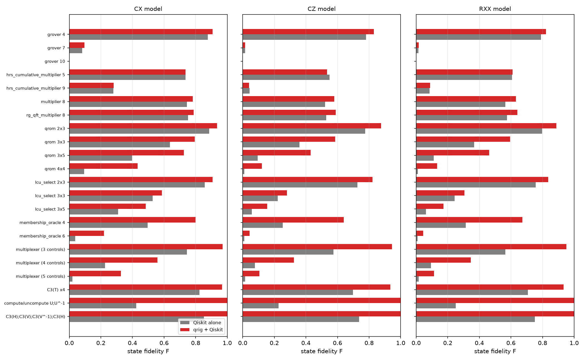
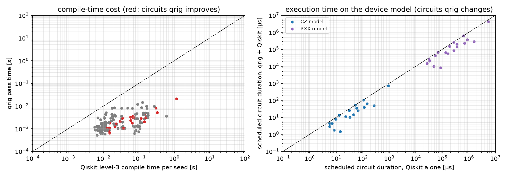
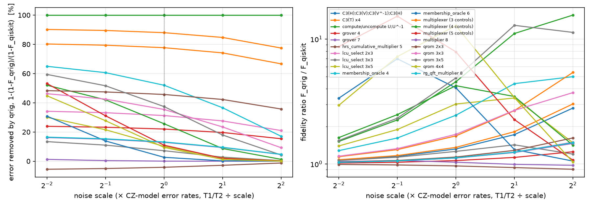
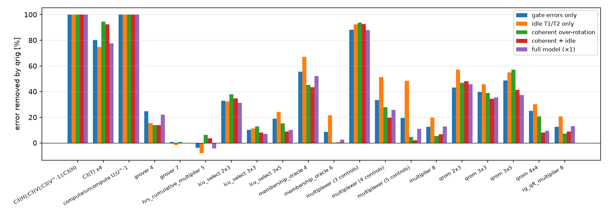

This document collects every result obtained with the `qrig` package so far. It is generated from the JSON result files by `python/benchmarks/make_report.py`; the PDF and the Markdown file have the same content. All numbers are **classical simulations** (Qiskit 2.5.2, Qiskit Aer 0.17.2, qrig 1.1.0, Python 3.11.14, 8 CPU cores). No real quantum hardware was used. The Lean proofs cover the optimiser core, not the measurements reported here.

**Key findings** (details and exceptions in Sections 4–9; summary repeated in Section 11):

* **Correctness**: every rewrite is proved sound in Lean; all 130 circuits checked exactly were identical after qrig; no circuit in any run was found non-equivalent.
* **Do no harm**: CX model: fewer 2q gates on 21, equal on 109, more on 0 of 130 circuits; CZ model: fewer 2q gates on 20, equal on 108, more on 2 of 130 circuits; RXX model: fewer 2q gates on 22, equal on 108, more on 0 of 130 circuits.
* **Where it helps**: qrig lowers the CZ-model two-qubit count in 4 application categories (arithmetic, control patterns, data loading & block encoding, search & oracles): circuits with multi-controlled gates next to each other or conjugated by NOT gates — Grover and SAT oracles, membership oracles, QROM / table lookup, LCU SELECT oracles, multiplexers, the MQT multipliers, compute/uncompute blocks. On circuits without such structure (QFT, QPE, VQE/QAOA ansätze, GHZ, W-state, Trotter circuits, swap test) it changes nothing and costs a few milliseconds.
* **Noise**: over the 66 simulated (circuit, target) pairs that qrig changes, the fidelity is higher with qrig in 62 and lower in 4 (grover 7 on CZ model: output close to fully mixed for both, F ≈ 2.1 × 2⁻ⁿ with n = 7; grover 10 on RXX model: output close to fully mixed for both, F ≈ 1.0 × 2⁻ⁿ with n = 10; hrs_cumulative_multiplier 5 on CZ model: qrig + Qiskit ends with more two-qubit gates, 122 → 128; hrs_cumulative_multiplier 9 on CZ model: qrig + Qiskit ends with more two-qubit gates, 484 → 494). Where the fidelity rises, the gain holds from ¼× to 4× today's error rates and under gate-only, idle-only and coherent noise (Section 8).
* **Other compilers**: Qiskit O3: qrig + Qiskit O3 has fewer 2q gates on 21, equal on 109, more on 0 of 130 circuits, total 29398 → 21896 (-25.5 %); TKET: qrig + TKET has fewer 2q gates on 17, equal on 112, more on 1 of 130 circuits, total 31933 → 26305 (-17.6 %); BQSKit: qrig + BQSKit has fewer 2q gates on 24, equal on 69, more on 0 of 93 circuits, total 10697 → 7423 (-30.6 %). The benefit is therefore not specific to Qiskit. TKET alone already reaches qrig's saving on the MQT Grover and multiplier circuits; on data loading (QROM, LCU SELECT, multiplexers), membership oracles and the control patterns, qrig lowers the count in front of all three compilers (Section 9).
* **Time**: the qrig pass costs milliseconds; the compiled circuits are shorter on the device and need fewer shots.
* **Fault tolerance**: T-count is mixed (Section 7).

# 1. Answers to the questions behind this study

**Is robustness a valid metric?** Yes, if it is defined precisely. In this study *robustness* means: does the benefit of adding qrig survive when the conditions change? We measure three versions of it: (i) across compiler randomness (10 transpiler seeds per circuit and target), (ii) across noise strength (all error rates of the CZ model scaled from ¼× to 4×), and (iii) across noise type (stochastic gate errors only, idle decoherence only, coherent over-rotations, coherent + idle). A pass whose gains vanish or reverse under one of these is fragile. Section 8 shows that, wherever qrig lowers the two-qubit count, the gain survives all of these changes; the exceptions are listed there.

**Is equivalence a robustness metric?** No. Equivalence (the optimised circuit implements exactly the same unitary) is a **correctness** property, and for qrig it is a *guarantee*, not a statistic: every rewrite rule is proved sound in Lean 4 (`peephole_sound`), and the executable core is compiled from that Lean code to C. We still check it empirically (exact unitary comparison and ideal-output comparison for every circuit, Section 3) because the Python ↔ Qiskit bridge is not proved. Correctness should be reported as its own column ("verified / checked"), next to the performance metrics, not as one of them.

**Which metrics show that qrig is useful?** We report six families, all with all-to-all connectivity so that hardware topology cannot bias the result:

| family | metric(s) | why it matters |
|---|---|---|
| correctness | proved rewrite soundness; exact unitary check; ideal outputs agree | an optimiser that may change the circuit is unusable |
| resources | two-qubit gate count, depth, two-qubit depth | two-qubit gates dominate error and time on every platform |
| noise | state fidelity F, task success P, estimated success probability ESP | what a user actually gets out of a noisy device |
| time | qrig pass time, Qiskit compile time, scheduled execution time, shots needed ∝ 1/F² | cost of using qrig vs time saved on the device |
| fault tolerance | T-count and arbitrary rotations after Clifford+T+Rz compilation | cost on future error-corrected machines |
| robustness | seed spread, noise-strength sweep, noise-type sweep | whether the gains are an artefact of one setting |

**Is the all-to-all experiment complete?** The earlier all-to-all experiment covered 17 circuits that were *selected because qrig reduced their gate count*. That is enough to show the effect exists, but it is a biased sample. This study extends it to **130 circuits**: every unitary MQT Bench benchmark at up to three sizes (87 circuits, not hand-picked), 37 application kernels written the textbook way (SAT-oracle Grover, membership oracles, QROM table lookup, LCU SELECT oracles, comparators, adders, Shor's modular adder, Hamming weight, state preparation, swap test, Ising Trotter steps, …), and the 6 control-pattern circuits of the earlier study; on three all-to-all targets, with all metric families above. Circuits up to 10 qubits are simulated exactly with density matrices; the earlier 12- and 16-qubit multiplier runs are included in Section 10. Section 9 repeats the comparison with two other compilers, TKET and BQSKit.

# 2. What qrig adds to the original paper

The paper *One rig to control them all* gives a sound and complete equational theory for quantum circuits with controlled gates (control equations (a)–(h), Figure 1). It does not give an implementation, an optimisation algorithm, or a measurement of their effect on noisy hardware. qrig contributes:

1. **A verified implementation.** The circuit language, its semantics, exact arithmetic in ℚ(ω), an exact equivalence checker, Gray-code permutation synthesis and a rewrite optimiser are written in Lean 4; the eight control equations and the soundness of every rewrite the optimiser performs are proved (no `sorry`, standard axioms only). The C code that runs is generated by the Lean compiler from this code.
2. **An optimisation algorithm built from the equations** (the paper has none): fusion/cancellation (a, b), complementarity C⁰(f)·C¹(f) = f (e), commutation (f) and diagonal commutation, and colour change — pushing NOT gates through controls (d) — applied to whole Qiskit DAGs within a 128-gate window.
3. **A usable package**: `import qrig`, a Qiskit transpiler pass (`QrigControlEquations`) that can be put in front of any Qiskit pipeline, conversion to/from Qiskit, and a test-suite (265 tests) against Qiskit's simulators.
4. **The empirical study in this document**: which real circuits benefit, by how much in gates, fidelity and time, and how robust the effect is.

Equivalence of every optimised circuit is a theorem, so improvements never cost correctness. The study below shows what they buy.

# 3. Set-up

**Pipelines.** *Qiskit alone* = Qiskit's preset pass manager at optimisation level 3 (its strongest). *qrig + Qiskit* = `qrig.dag.optimize_circuit` first, then the same level-3 pass manager. For each circuit, target and pipeline we compile with 10 transpiler seeds and keep the compilation with the highest estimated success probability (what a user would do); the spread over seeds is reported in Section 6.

**Targets.** All three targets are all-to-all; they differ in native two-qubit gate (CX, CZ, RXX) and noise parameters. The CZ model uses the median FakeTorino calibration (an IBM Heron-generation snapshot shipped with Qiskit); the RXX model uses assumed values. Only the calibration numbers are borrowed: the CZ model is not a model of that device, which is not all-to-all and whose readout error and crosstalk are omitted here. Below, the targets are called the CX, CZ and RXX models.

| target | native gates | noise model |
|---|---|---|
| CX model | cx, rz, sx, x | p2 = 0.3%, p1 = 0.03%, no idle noise |
| CZ model | cz, rz, sx, x | median FakeTorino calibration: cz error 0.419%, 1q error 0.0271%, cz 0.068 µs, 1q 0.032 µs, T1 185 µs, T2 138.2 µs; idle relaxation in an ALAP schedule |
| RXX model | rxx, rz, sx, x | assumed round numbers (not a vendor calibration): rxx error 0.5%, 1q error 0.03%, rxx 600 µs, 1q 100 µs, T1 1e+08 µs, T2 1e+06 µs; idle relaxation |

**Circuits.**

| suite | circuits | families (qubit counts) |
|---|---|---|
| MQT Bench (neutral suite) | 87 | ae (4, 7, 10); bmw_quark_cardinality (4, 7, 10); bmw_quark_copula (4, 8, 10); bv (4, 7, 10); cdkm_ripple_carry_adder (4, 8, 10); dj (4, 7, 10); draper_qft_adder (4, 8, 10); full_adder (4, 8, 10); ghz (4, 7, 10); graphstate (4, 7, 10); grover (4, 7, 10); half_adder (5, 7, 9); hhl (4, 7, 10); hrs_cumulative_multiplier (5, 9); modular_adder (4, 8, 10); multiplier (4, 8); qaoa (4, 7, 10); qft (4, 7, 10); qftentangled (4, 7, 10); qnn (4, 7, 10); qpeexact (4, 7, 10); qpeinexact (4, 7, 10); qwalk (4, 7, 10); randomcircuit (4, 7, 10); rg_qft_multiplier (4, 8); vbe_ripple_carry_adder (4, 7, 10); vqe_real_amp (4, 7, 10); vqe_su2 (4, 7, 10); vqe_two_local (4, 7, 10); wstate (4, 7, 10) |
| application kernels | 37 | comparator (6, 8, 10); grover_sat (7, 9, 10); hamming_weight (5, 8, 10); incrementer (4, 6, 8); ising_trotter (6, 10); lcu_select (5, 6, 8); lib_grover (4, 5, 6); membership_oracle (5, 7); poly_rotation (4, 6); qrom (5, 6, 8, 8); shor_modadd (7, 8); state_prep (3, 5); swap_test (5, 7, 9); weighted_adder (9, 10) |
| control-pattern circuits | 6 | C3(H);C3(V);C3(V^-1);C3(H) (4); C3(T) (4); compute/uncompute U;U^-1 (4); multiplexer (4, 5, 6) |

The MQT suite contains every unitary benchmark of MQT Bench at the algorithm level (dynamic circuits with mid-circuit measurement, and benchmarks with no instance in the size range, are excluded). Sizes are the smallest, middle and largest admissible size between 4 and 10 qubits. The application kernels are written the way a Qiskit user writes them (library objects or the textbook construction); their source is `python/benchmarks/app_circuits.py`. The control-pattern circuits contain exactly the patterns the control equations target and are reported separately so that they do not inflate the averages.

**Metrics.** F = state fidelity ⟨ψ|ρ|ψ⟩ averaged over 3 random product input states; P = Hellinger fidelity of the output distribution for one classical input (the success probability when the answer is deterministic); *error removed* = 1 − (1 − F_qrig)/(1 − F_Qiskit); *ratio* = F_qrig/F_Qiskit; ESP = ∏(1 − e_gate). When noise scales a measured signal by F, the shots needed for a fixed precision scale like 1/F², so the *shot saving* is (F_qrig/F_Qiskit)². Duration = length of the ALAP-scheduled compiled circuit.

## 3.1 Correctness checks (all circuits)

* qrig rewrote 88 of the 130 circuits (at least one rule applied).
* Exact unitary comparison, qrig output vs input circuit: 130 of 130 circuits identical up to 10⁻⁸ in every matrix entry (not up to global phase — exactly).
* Ideal (noise-free) outputs of the two compiled circuits agree in 390 of 390 (circuit, target) pairs, and agree with the statevector of the original benchmark in 390 of 390.
* Earlier MQT pipeline run (74 circuits up to 128 qubits): MQT QCEC proved the qrig output equivalent for 72 circuits; the rest timed out; none was found non-equivalent.

## 3.2 What is proved in Lean about the kernels and the metrics

Besides the soundness of every qrig rewrite, `QrigProofs/Study/` proves what several application kernels compute and the properties of the metrics this report relies on (no `sorry`, standard axioms only):

| file | theorems | statement |
|---|---|---|
| `Reversible.lean` | `incrementer_spec`, `hamming_weight_correct`, `memberOracle_spec`, `qrom_spec` | incrementer adds 1 mod 2ⁿ; the Hamming-weight counter ends with the popcount; the membership oracle flips its target iff the input is in the set; QROM XORs table[address] into the data register |
| `Reversible.lean` | `run_xconj` | colour change (d) on basis states: NOT gates around a block flip the polarity of the controls they touch (the rewrite qrig applies to these kernels) |
| `Draper.lean` | `phiAdd_correct`, `phiAddOld_wrong` | the phase angles of the Draper adder in `shor_modadd` map QFT\|x⟩ to QFT\|(x+a) mod 2ⁿ⟩ under Qiskit's `QFTGate` convention; the angle formula used before a fix during the study does not |
| `Metrics.lean` | `esp_sublist_le`, `espUniform_robust`, `espUniform_tradeoff_not_robust` | removing gates never lowers ESP; no more 1q and no more 2q gates ⇒ ESP at least as high at every noise scale; with a 1q/2q trade-off the ESP comparison can flip |
| `Metrics.lean` | `shotsNeeded_div`, `geomean_le_one`, `geomean_lt_one` | shot saving = (F_qrig/F_Qiskit)²; if no circuit gets worse the per-circuit geometric-mean ratio is ≤ 1, and < 1 once one circuit improves |

The kernel theorems are about a Lean gate-list model written to mirror `python/benchmarks/app_circuits.py`; `python/tests/test_kernels.py` runs the actual Qiskit circuits on every basis state and checks them against the same specifications. The simulated numbers themselves are not checked in Lean.

# 4. Resources: two-qubit gates and depth



| suite | target | fewer 2q | equal | more 2q | total 2q gates | change |
|---|---|---|---|---|---|---|
| MQT Bench (neutral suite) | CX model | 6 | 81 | 0 | 18961 → 16907 | -10.8 % |
| MQT Bench (neutral suite) | CZ model | 5 | 80 | 2 | 18961 → 16925 | -10.7 % |
| MQT Bench (neutral suite) | RXX model | 7 | 80 | 0 | 16854 → 14995 | -11.0 % |
| application kernels | CX model | 9 | 28 | 0 | 6578 → 4279 | -34.9 % |
| application kernels | CZ model | 9 | 28 | 0 | 6578 → 4279 | -34.9 % |
| application kernels | RXX model | 9 | 28 | 0 | 5858 → 3779 | -35.5 % |
| control-pattern circuits | CX model | 6 | 0 | 0 | 3859 → 710 | -81.6 % |
| control-pattern circuits | CZ model | 6 | 0 | 0 | 3859 → 710 | -81.6 % |
| control-pattern circuits | RXX model | 6 | 0 | 0 | 3302 → 614 | -81.4 % |
| **all** | CX model | 21 | 109 | 0 | 29398 → 21896 | -25.5 % |
| **all** | CZ model | 20 | 108 | 2 | 29398 → 21914 | -25.5 % |
| **all** | RXX model | 22 | 108 | 0 | 26014 → 19388 | -25.5 % |

*fewer/equal/more*: number of circuits where qrig + Qiskit has fewer / the same / more two-qubit gates than Qiskit alone (best seed of each).

Circuits whose two-qubit count changes on at least one target:

| circuit | qubits | 2q (CX) | 2q (CZ) | 2q (RXX) | depth (CZ) | rules applied |
|---|---|---|---|---|---|---|
| grover 4 | 4 | 52 → 38 | 52 → 38 | 44 → 36 | 186 → 148 | xconj 4 |
| grover 7 | 7 | 1092 → 996 | 1092 → 996 | 990 → 918 | 3463 → 3298 | xconj 30 |
| grover 10 | 10 | 8874 → 6970 | 8874 → 6970 | 8211 → 6477 | 28913 → 22799 | xconj 136 |
| hrs_cumulative_multiplier 5 | 5 | 122 → 122 | 122 → 128 | 91 → 90 | 438 → 458 | fuse 1, cancel 1 |
| hrs_cumulative_multiplier 9 | 9 | 484 → 482 | 484 → 494 | 358 → 352 | 1743 → 1772 | fuse 4, cancel 4 |
| multiplier 8 | 8 | 115 → 96 | 115 → 96 | 91 → 72 | 272 → 233 | idRem 4 |
| rg_qft_multiplier 8 | 8 | 115 → 96 | 115 → 96 | 91 → 72 | 272 → 233 | idRem 4 |
| qrom 2x3 | 5 | 48 → 26 | 48 → 26 | 40 → 21 | 188 → 100 | compl 2, xconj 4 |
| qrom 3x3 | 6 | 182 → 92 | 182 → 92 | 169 → 85 | 688 → 351 | compl 4, xconj 12 |
| qrom 3x5 | 8 | 364 → 122 | 364 → 122 | 338 → 110 | 1356 → 447 | compl 12, xconj 12 |
| qrom 4x4 | 8 | 936 → 322 | 936 → 322 | 864 → 297 | 3431 → 1185 | compl 17, xconj 32 |
| lcu_select 2x3 | 5 | 60 → 38 | 60 → 38 | 50 → 32 | 239 → 145 | compl 2, xconj 4 |
| lcu_select 3x3 | 6 | 252 → 208 | 252 → 208 | 234 → 192 | 951 → 790 | cancel 5, compl 2, xconj 12 |
| lcu_select 3x5 | 8 | 476 → 289 | 476 → 289 | 442 → 265 | 1781 → 1068 | cancel 11, compl 9, xconj 12 |
| membership_oracle 4 | 5 | 288 → 92 | 288 → 92 | 216 → 72 | 1040 → 333 | compl 4, xconj 19 |
| membership_oracle 6 | 7 | 1488 → 606 | 1488 → 606 | 1356 → 556 | 4320 → 1923 | compl 5, xconj 33 |
| multiplexer (3 controls) | 4 | 122 → 12 | 122 → 12 | 111 → 10 | 443 → 49 | compl 5 |
| multiplexer (4 controls) | 5 | 624 → 232 | 624 → 232 | 492 → 192 | 2061 → 765 | compl 7 |
| multiplexer (5 controls) | 6 | 2626 → 452 | 2626 → 452 | 2305 → 399 | 8085 → 1578 | compl 20 |
| C3(T) x4 | 4 | 80 → 14 | 80 → 14 | 68 → 13 | 255 → 57 | fuse 3 |
| compute/uncompute U;U^-1 | 4 | 343 → 0 | 343 → 0 | 272 → 0 | 1137 → 0 | cancel 29, xconj 1 |
| C3(H);C3(V);C3(V^-1);C3(H) | 4 | 64 → 0 | 64 → 0 | 54 → 0 | 227 → 0 | cancel 2 |

Rules: `xconj` colour change (d), `compl` complementarity (e), `cancel`/`fuse` equations (a)/(b), `idRem` identity removal.

## 4.1 Results by application category

To show that the effect is not limited to one algorithm (e.g. Grover), the circuits are grouped by what they are used for. *fewer/more*: circuits with fewer / more two-qubit gates after qrig; the percentage is the change of the category total.

| category | circuits | families | rewritten | CX target: fewer/more; total | CZ: fewer/more; total | largest CZ reduction |
|---|---|---|---|---|---|---|
| search & oracles | 17 | 6 | 17 | 5/0; -24.7 % | 5/0; -24.7 % | membership_oracle 4 (288 → 92) |
| arithmetic | 37 | 14 | 25 | 3/0; -1.3 % | 2/2; -0.7 % | multiplier 8 (115 → 96) |
| data loading & block encoding | 14 | 5 | 14 | 10/0; -66.1 % | 10/0; -66.1 % | multiplexer (3 controls) (122 → 12) |
| Fourier & phase estimation | 18 | 6 | 6 | 0/0; +0.0 % | 0/0; +0.0 % | – |
| simulation & walks | 5 | 2 | 5 | 0/0; +0.0 % | 0/0; +0.0 % | – |
| variational, ML & finance | 21 | 7 | 12 | 0/0; +0.0 % | 0/0; +0.0 % | – |
| states & primitives | 15 | 5 | 6 | 0/0; +0.0 % | 0/0; +0.0 % | – |
| control patterns | 3 | 3 | 3 | 3/0; -97.1 % | 3/0; -97.1 % | compute/uncompute U;U^-1 (343 → 0) |

Outside search/oracle circuits and the control-pattern circuits, qrig lowers the CZ-model two-qubit count on 12 of 110 circuits.

Per-circuit view (each circuit weighted equally, so a few large circuits cannot dominate):

| target | geometric mean of 2q ratio, all circuits | geometric mean, circuits whose count changes | median reduction where it drops | largest reduction |
|---|---|---|---|---|
| CX model | 0.893 | 0.467 | 49 % | 100 % |
| CZ model | 0.894 | 0.487 | 54 % | 100 % |
| RXX model | 0.893 | 0.486 | 49 % | 100 % |

# 5. Noise: fidelity of the compiled circuits



| circuit | F (CX) | F (CZ) | F (RXX) | error removed (CZ) | ratio (CZ) | shot saving (CZ) |
|---|---|---|---|---|---|---|
| grover 4 | 0.876 → 0.906 | 0.781 → 0.830 | 0.790 → 0.823 | +22 % | ×1.06 | ×1.13 |
| grover 7 | 0.081 → 0.096 | 0.016 → 0.015 | 0.014 → 0.015 (scr.) | -0 % | ×0.94 | ×0.88 |
| grover 10 | 1.0e-03 → 1.0e-03 (scr.) | 9.5e-04 → 1.0e-03 (scr.) | 9.8e-04 → 9.8e-04 (scr.) | +0 % | ×1.08 | – |
| hrs_cumulative_multiplier 5 | 0.736 → 0.737 | 0.549 → 0.533 | 0.606 → 0.610 | -3 % | ×0.97 | ×0.94 |
| hrs_cumulative_multiplier 9 | 0.280 → 0.281 | 0.044 → 0.041 | 0.085 → 0.088 | -0 % | ×0.93 | ×0.86 |
| multiplier 8 | 0.745 → 0.781 | 0.521 → 0.580 | 0.565 → 0.631 | +12 % | ×1.11 | ×1.24 |
| rg_qft_multiplier 8 | 0.751 → 0.787 | 0.528 → 0.589 | 0.575 → 0.640 | +13 % | ×1.12 | ×1.25 |
| qrom 2x3 | 0.885 → 0.935 | 0.775 → 0.876 | 0.798 → 0.886 | +45 % | ×1.13 | ×1.28 |
| qrom 3x3 | 0.638 → 0.793 | 0.359 → 0.584 | 0.367 → 0.594 | +35 % | ×1.63 | ×2.65 |
| qrom 3x5 | 0.397 → 0.726 | 0.096 → 0.430 | 0.112 → 0.462 | +37 % | ×4.49 | ×20.19 |
| qrom 4x4 | 0.094 → 0.433 | 9.5e-03 → 0.122 | 0.011 → 0.132 | +11 % | ×12.78 | ×163.43 |
| lcu_select 2x3 | 0.858 → 0.906 | 0.727 → 0.821 | 0.757 → 0.836 | +34 % | ×1.13 | ×1.28 |
| lcu_select 3x3 | 0.529 → 0.587 | 0.221 → 0.281 | 0.244 → 0.305 | +8 % | ×1.27 | ×1.61 |
| lcu_select 3x5 | 0.310 → 0.483 | 0.057 → 0.155 | 0.061 → 0.173 | +10 % | ×2.72 | ×7.42 |
| membership_oracle 4 | 0.497 → 0.799 | 0.253 → 0.640 | 0.314 → 0.672 | +52 % | ×2.53 | ×6.39 |
| membership_oracle 6 | 0.038 → 0.219 | 0.010 → 0.044 | 9.6e-03 → 0.045 | +3 % | ×4.32 | ×18.67 |
| multiplexer (3 controls) | 0.746 → 0.970 | 0.574 → 0.944 | 0.564 → 0.951 | +87 % | ×1.64 | ×2.70 |
| multiplexer (4 controls) | 0.226 → 0.557 | 0.077 → 0.323 | 0.093 → 0.346 | +27 % | ×4.18 | ×17.44 |
| multiplexer (5 controls) | 0.020 → 0.327 | 0.016 → 0.105 | 0.016 → 0.113 | +9 % | ×6.79 | ×46.17 |
| C3(T) x4 | 0.824 → 0.967 | 0.698 → 0.934 | 0.707 → 0.934 | +78 % | ×1.34 | ×1.79 |
| compute/uncompute U;U^-1 | 0.424 → 1.000 | 0.226 → 1.000 | 0.251 → 1.000 | +100 % | ×4.42 | ×19.54 |
| C3(H);C3(V);C3(V^-1);C3(H) | 0.852 → 1.000 | 0.736 → 1.000 | 0.751 → 1.000 | +100 % | ×1.36 | ×1.85 |

*(scr.)*: both fidelities below 2/2ⁿ, i.e. the output is essentially noise either way.

Over the 66 simulated (circuit, target) pairs that qrig changes, the fidelity is higher with qrig in 62 and lower in 4: grover 7 on CZ model (0.016 → 0.015); grover 10 on RXX model (9.8e-04 → 9.8e-04); hrs_cumulative_multiplier 5 on CZ model (0.549 → 0.533); hrs_cumulative_multiplier 9 on CZ model (0.044 → 0.041).

For the 42 circuits that qrig leaves exactly unchanged, both pipelines produce the same compiled circuit and therefore the same fidelity (not simulated twice).

# 6. Time



* **Compile-time cost.** qrig pass: median 1.7 ms, maximum 0.02 s per circuit. Qiskit level 3 (one seed, CZ model): median 21.5 ms, maximum 1.16 s. Median ratio qrig/Qiskit 0.07.
* **Execution time on the device.** Removing gates also shortens the scheduled circuit, so each shot runs faster and (Section 5) fewer shots are needed:

| circuit | duration, CZ model | duration, RXX model |
|---|---|---|
| grover 4 | 5.7 → 4.5 µs (-21 %) | 31.4 → 27.4 ms (-13 %) |
| grover 7 | 107.8 → 105.1 µs (-2 %) | 631.4 → 623.0 ms (-1 %) |
| grover 10 | 925.0 → 720.6 µs (-22 %) | 5502.0 → 4267.9 ms (-22 %) |
| hrs_cumulative_multiplier 5 | 12.9 → 13.6 µs (+5 %) | 68.2 → 67.4 ms (-1 %) |
| hrs_cumulative_multiplier 9 | 51.8 → 52.5 µs (+1 %) | 269.0 → 264.2 ms (-2 %) |
| multiplier 8 | 9.6 → 7.8 µs (-19 %) | 54.4 → 43.1 ms (-21 %) |
| rg_qft_multiplier 8 | 9.6 → 7.8 µs (-19 %) | 54.4 → 43.1 ms (-21 %) |
| qrom 2x3 | 5.6 → 2.9 µs (-48 %) | 26.6 → 14.6 ms (-45 %) |
| qrom 3x3 | 22.7 → 11.2 µs (-51 %) | 134.2 → 65.4 ms (-51 %) |
| qrom 3x5 | 45.1 → 14.4 µs (-68 %) | 268.1 → 84.0 ms (-69 %) |
| qrom 4x4 | 113.4 → 38.9 µs (-66 %) | 676.0 → 230.9 ms (-66 %) |
| lcu_select 2x3 | 7.1 → 4.3 µs (-39 %) | 32.9 → 20.9 ms (-36 %) |
| lcu_select 3x3 | 31.2 → 25.6 µs (-18 %) | 185.7 → 151.7 ms (-18 %) |
| lcu_select 3x5 | 58.8 → 34.7 µs (-41 %) | 350.5 → 206.1 ms (-41 %) |
| membership_oracle 4 | 32.6 → 10.4 µs (-68 %) | 161.8 → 55.0 ms (-66 %) |
| membership_oracle 6 | 146.4 → 62.7 µs (-57 %) | 881.6 → 373.7 ms (-58 %) |
| multiplexer (3 controls) | 14.3 → 1.5 µs (-90 %) | 85.5 → 8.2 ms (-90 %) |
| multiplexer (4 controls) | 65.8 → 24.4 µs (-63 %) | 351.2 → 137.3 ms (-61 %) |
| multiplexer (5 controls) | 265.4 → 49.1 µs (-81 %) | 1582.1 → 283.7 ms (-82 %) |
| C3(T) x4 | 8.4 → 1.8 µs (-79 %) | 47.9 → 10.2 ms (-79 %) |
| compute/uncompute U;U^-1 | 36.5 → 0.0 µs (-100 %) | 195.8 → 0.0 ms (-100 %) |
| C3(H);C3(V);C3(V^-1);C3(H) | 7.4 → 0.0 µs (-100 %) | 41.0 → 0.0 ms (-100 %) |

Time-to-solution for a fixed precision scales roughly like duration × 1/F² (ignoring fixed per-shot overheads such as reset and readout); both factors fall with qrig on the circuits above.

# 7. Fault-tolerant cost (T-count)

Both pipelines compiled with Qiskit level 3 to {cx, h, s, sdg, t, tdg, x, z, rz}; `rz` angles that are odd multiples of π/4 count as T, other non-Clifford angles as *arbitrary rotations* (each costs tens of T gates after synthesis).

| circuit | T-count | arbitrary rotations | CX |
|---|---|---|---|
| grover 4 | 46 → 13 | 14 → 35 | 52 → 38 |
| grover 7 | 630 → 558 | 618 → 570 | 1092 → 996 |
| grover 10 | 7650 → 4301 | 2431 → 3825 | 8874 → 6970 |
| hrs_cumulative_multiplier 5 | 100 → 100 | 44 → 43 | 124 → 124 |
| hrs_cumulative_multiplier 9 | 392 → 392 | 172 → 175 | 488 → 486 |
| multiplier 8 | 37 → 37 | 64 → 64 | 120 → 96 |
| rg_qft_multiplier 8 | 37 → 37 | 64 → 64 | 120 → 96 |
| qrom 2x3 | 50 → 26 | 0 → 0 | 48 → 26 |
| qrom 3x3 | 3 → 27 | 187 → 71 | 182 → 92 |
| qrom 3x5 | 2 → 38 | 368 → 89 | 364 → 122 |
| qrom 4x4 | 1008 → 180 | 0 → 164 | 936 → 322 |
| lcu_select 2x3 | 62 → 40 | 0 → 0 | 60 → 38 |
| lcu_select 3x3 | 2 → 13 | 258 → 202 | 252 → 208 |
| lcu_select 3x5 | 0 → 49 | 482 → 270 | 476 → 289 |
| membership_oracle 4 | 176 → 51 | 165 → 55 | 288 → 92 |
| membership_oracle 6 | 456 → 290 | 1136 → 379 | 1488 → 606 |
| multiplexer (3 controls) | 26 → 9 | 106 → 7 | 124 → 13 |
| multiplexer (4 controls) | 438 → 153 | 286 → 117 | 624 → 234 |
| multiplexer (5 controls) | 1606 → 369 | 1347 → 159 | 2688 → 454 |
| C3(T) x4 | 48 → 4 | 41 → 17 | 80 → 14 |
| compute/uncompute U;U^-1 | 202 → 0 | 193 → 0 | 349 → 0 |
| C3(H);C3(V);C3(V^-1);C3(H) | 14 → 0 | 60 → 0 | 66 → 0 |

qrig lowers the T-count on 14 of the 22 circuits it changes. On 4 circuits (grover 4, grover 10, hrs_cumulative_multiplier 9, qrom 4x4) it *increases* the number of arbitrary rotations: Qiskit synthesises the multi-controlled gates that qrig emits (e.g. C³Z instead of a multi-controlled phase of π) without ancillas, using π/8-type rotations. This is a property of Qiskit's ancilla-free synthesis, not of the rewrite; T-count is therefore a mixed metric for qrig today and an open improvement (emit the multi-controlled gates in the form Qiskit synthesises best).

# 8. Robustness

## 8.1 Across compiler randomness (transpiler seeds)

| circuit | 2q min/median/max, CX | CZ | RXX | seeds no worse (CZ) |
|---|---|---|---|---|
| grover 4 | 52/52/52 → 38/38/38 | 52/52/52 → 38/38/38 | 44/44/44 → 36/36/36 | 100 % |
| grover 7 | 1092/1092/1092 → 996/996/996 | 1092/1092/1092 → 996/996/996 | 990/990/990 → 918/918/918 | 100 % |
| grover 10 | 8874/8874/8874 → 6970/6970/6970 | 8874/8874/8874 → 6970/6970/6970 | 8211/8211/8211 → 6477/6477/6477 | 100 % |
| hrs_cumulative_multiplier 5 | 122/122/122 → 122/122/122 | 122/122/122 → 128/128/128 | 91/91/91 → 90/90/90 | 0 % |
| hrs_cumulative_multiplier 9 | 484/484/484 → 482/482/482 | 484/484/484 → 494/494/494 | 358/358/358 → 352/352/352 | 0 % |
| multiplier 8 | 115/115/115 → 96/96/96 | 115/115/115 → 96/96/96 | 91/91/91 → 72/72/72 | 100 % |
| rg_qft_multiplier 8 | 115/115/115 → 96/96/96 | 115/115/115 → 96/96/96 | 91/91/91 → 72/72/72 | 100 % |
| qrom 2x3 | 48/48/48 → 26/26/26 | 48/48/48 → 26/26/26 | 40/40/40 → 21/21/21 | 100 % |
| qrom 3x3 | 182/182/182 → 92/92/92 | 182/182/182 → 92/92/92 | 169/169/169 → 85/85/85 | 100 % |
| qrom 3x5 | 364/364/364 → 122/122/122 | 364/364/364 → 122/122/122 | 338/338/338 → 110/110/110 | 100 % |
| qrom 4x4 | 936/936/936 → 322/322/322 | 936/936/936 → 322/322/322 | 864/864/864 → 297/297/297 | 100 % |
| lcu_select 2x3 | 60/60/60 → 38/38/38 | 60/60/60 → 38/38/38 | 50/50/50 → 32/32/32 | 100 % |
| lcu_select 3x3 | 252/252/252 → 208/208/208 | 252/252/252 → 208/208/208 | 234/234/234 → 192/192/192 | 100 % |
| lcu_select 3x5 | 476/476/476 → 289/289/289 | 476/476/476 → 289/289/289 | 442/442/442 → 265/265/265 | 100 % |
| membership_oracle 4 | 288/288/288 → 92/92/92 | 288/288/288 → 92/92/92 | 216/216/216 → 72/72/72 | 100 % |
| membership_oracle 6 | 1488/1488/1488 → 606/606/606 | 1488/1488/1488 → 606/606/606 | 1356/1356/1356 → 556/556/556 | 100 % |
| multiplexer (3 controls) | 122/122/122 → 12/12/12 | 122/122/122 → 12/12/12 | 111/111/111 → 10/10/10 | 100 % |
| multiplexer (4 controls) | 624/624/624 → 232/232/232 | 624/624/624 → 232/232/232 | 492/492/492 → 192/192/192 | 100 % |
| multiplexer (5 controls) | 2626/2626/2626 → 452/452/452 | 2626/2626/2626 → 452/452/452 | 2305/2305/2305 → 399/399/399 | 100 % |
| C3(T) x4 | 80/80/80 → 14/14/14 | 80/80/80 → 14/14/14 | 68/68/68 → 13/13/13 | 100 % |
| compute/uncompute U;U^-1 | 343/343/343 → 0/0/0 | 343/343/343 → 0/0/0 | 272/272/272 → 0/0/0 | 100 % |
| C3(H);C3(V);C3(V^-1);C3(H) | 64/64/64 → 0/0/0 | 64/64/64 → 0/0/0 | 54/54/54 → 0/0/0 | 100 % |

Over all 3900 (circuit, target, seed) compilations, qrig + Qiskit used no more two-qubit gates than Qiskit alone with the same seed in 3880 (99.5 %).

Note: with all-to-all connectivity there is no layout or routing step, which is where Qiskit's randomness mostly acts; the two-qubit count varies across seeds in only 0 of the 780 (circuit, target, pipeline) combinations. Seed robustness is therefore close to automatic here; it becomes a real test on a restricted topology (Section 10).

## 8.2 Across noise strength

Circuits whose CZ-model two-qubit count qrig changes and that have at most 8 qubits (20 circuits) were re-simulated on the CZ model with every gate error multiplied, and T1/T2 divided, by a common scale factor (the compiled circuits are the same; only the noise changes).



| circuit | scale 0.25 | scale 0.5 | scale 1 | scale 2 | scale 4 |
|---|---|---|---|---|---|
| C3(H);C3(V);C3(V^-1);C3(H) | +100 % (×1.07) | +100 % (×1.15) | +100 % (×1.32) | +100 % (×1.72) | +100 % (×2.80) |
| C3(T) x4 | +80 % (×1.08) | +79 % (×1.17) | +78 % (×1.36) | +74 % (×1.81) | +67 % (×3.02) |
| compute/uncompute U;U^-1 | +100 % (×1.52) | +100 % (×2.25) | +100 % (×4.55) | +100 % (×11.08) | +100 % (×15.56) |
| grover 4 | +24 % (×1.02) | +23 % (×1.03) | +22 % (×1.06) | +20 % (×1.13) | +15 % (×1.25) |
| grover 7 | +1 % (×1.04) | +0 % (×1.07) | +0 % (×1.03) | -0 % (×0.99) | -0 % (×0.98) |
| hrs_cumulative_multiplier 5 | -6 % (×0.99) | -5 % (×0.98) | -4 % (×0.96) | -3 % (×0.93) | -1 % (×0.91) |
| lcu_select 2x3 | +34 % (×1.03) | +33 % (×1.06) | +31 % (×1.12) | +28 % (×1.24) | +21 % (×1.50) |
| lcu_select 3x3 | +13 % (×1.07) | +11 % (×1.13) | +7 % (×1.26) | +3 % (×1.42) | +0 % (×1.20) |
| lcu_select 3x5 | +30 % (×1.39) | +22 % (×1.89) | +10 % (×3.02) | +2 % (×3.37) | +0 % (×1.48) |
| membership_oracle 4 | +65 % (×1.28) | +61 % (×1.61) | +52 % (×2.46) | +37 % (×4.40) | +17 % (×5.00) |
| membership_oracle 6 | +31 % (×3.36) | +14 % (×6.95) | +3 % (×4.07) | +0 % (×1.30) | +0 % (×1.05) |
| multiplexer (3 controls) | +90 % (×1.14) | +89 % (×1.30) | +88 % (×1.68) | +85 % (×2.67) | +77 % (×5.41) |
| multiplexer (4 controls) | +52 % (×1.63) | +42 % (×2.48) | +26 % (×4.23) | +9 % (×3.47) | +1 % (×1.41) |
| multiplexer (5 controls) | +53 % (×8.72) | +31 % (×15.25) | +11 % (×7.91) | +2 % (×2.27) | +0 % (×1.07) |
| multiplier 8 | +16 % (×1.03) | +15 % (×1.06) | +13 % (×1.12) | +9 % (×1.23) | +5 % (×1.46) |
| qrom 2x3 | +48 % (×1.03) | +47 % (×1.07) | +46 % (×1.14) | +42 % (×1.28) | +36 % (×1.62) |
| qrom 3x3 | +46 % (×1.15) | +42 % (×1.33) | +35 % (×1.73) | +23 % (×2.69) | +9 % (×3.73) |
| qrom 3x5 | +59 % (×1.54) | +52 % (×2.32) | +37 % (×4.88) | +18 % (×12.89) | +4 % (×11.31) |
| qrom 4x4 | +45 % (×2.95) | +28 % (×7.24) | +9 % (×12.81) | +1 % (×3.40) | +0 % (×1.04) |
| rg_qft_multiplier 8 | +16 % (×1.03) | +15 % (×1.06) | +13 % (×1.12) | +10 % (×1.24) | +5 % (×1.48) |

## 8.3 Across noise type



| circuit (F: Qiskit → qrig) | gate errors only | idle T1/T2 only | coherent | coherent + idle |
|---|---|---|---|---|
| C3(H);C3(V);C3(V^-1);C3(H) | 0.795 → 1.000 | 0.952 → 1.000 | 0.629 → 1.000 | 0.601 → 1.000 |
| C3(T) x4 | 0.745 → 0.949 | 0.918 → 0.979 | 0.145 → 0.953 | 0.139 → 0.933 |
| compute/uncompute U;U^-1 | 0.284 → 1.000 | 0.721 → 1.000 | 0.293 → 1.000 | 0.227 → 1.000 |
| grover 4 | 0.817 → 0.862 | 0.949 → 0.957 | 0.842 → 0.864 | 0.799 → 0.827 |
| grover 7 | 0.028 → 0.034 | 0.141 → 0.126 | 1.1e-03 → 9.0e-03 | 7.3e-03 → 7.9e-03 |
| hrs_cumulative_multiplier 5 | 0.627 → 0.612 | 0.851 → 0.839 | 0.276 → 0.322 | 0.242 → 0.270 |
| lcu_select 2x3 | 0.794 → 0.862 | 0.915 → 0.943 | 0.822 → 0.889 | 0.754 → 0.839 |
| lcu_select 3x3 | 0.369 → 0.434 | 0.561 → 0.611 | 0.269 → 0.362 | 0.167 → 0.235 |
| lcu_select 3x5 | 0.160 → 0.319 | 0.243 → 0.427 | 0.143 → 0.273 | 0.041 → 0.125 |
| membership_oracle 4 | 0.359 → 0.715 | 0.697 → 0.900 | 0.334 → 0.635 | 0.250 → 0.575 |
| membership_oracle 6 | 0.014 → 0.098 | 0.059 → 0.261 | 0.015 → 0.018 | 9.2e-03 → 0.014 |
| multiplexer (3 controls) | 0.635 → 0.956 | 0.883 → 0.991 | 0.501 → 0.969 | 0.450 → 0.960 |
| multiplexer (4 controls) | 0.119 → 0.413 | 0.452 → 0.732 | 9.9e-03 → 0.285 | 0.032 → 0.221 |
| multiplexer (5 controls) | 0.017 → 0.208 | 0.065 → 0.518 | 2.1e-03 → 0.048 | 0.020 → 0.040 |
| multiplier 8 | 0.647 → 0.691 | 0.811 → 0.848 | 0.503 → 0.530 | 0.409 → 0.450 |
| qrom 2x3 | 0.829 → 0.903 | 0.929 → 0.969 | 0.835 → 0.912 | 0.777 → 0.884 |
| qrom 3x3 | 0.488 → 0.692 | 0.658 → 0.814 | 0.502 → 0.696 | 0.344 → 0.570 |
| qrom 3x5 | 0.252 → 0.615 | 0.316 → 0.691 | 0.182 → 0.649 | 0.069 → 0.453 |
| qrom 4x4 | 0.031 → 0.274 | 0.063 → 0.347 | 8.6e-03 → 0.214 | 6.8e-03 → 0.086 |
| rg_qft_multiplier 8 | 0.646 → 0.690 | 0.808 → 0.848 | 0.533 → 0.568 | 0.433 → 0.483 |

*Coherent*: every two-qubit gate is followed by an unwanted RZZ(0.1 rad) and every `sx`/`x` by RX(0.02 rad), no stochastic noise. Coherent errors can add up or cancel depending on the circuit, so this is the hardest case for any claim of the form "fewer gates ⇒ higher fidelity".

Across all 180 (circuit, noise variant) simulations the qrig circuit has the higher fidelity in 170; the exceptions are grover 7 (scaled 2: 7.3e-03 → 7.2e-03); grover 7 (scaled 4: 7.0e-03 → 6.8e-03); grover 7 (idle_only 1: 0.141 → 0.126); hrs_cumulative_multiplier 5 (scaled 0.25: 0.853 → 0.845); hrs_cumulative_multiplier 5 (scaled 0.5: 0.729 → 0.716); hrs_cumulative_multiplier 5 (scaled 1: 0.537 → 0.518); hrs_cumulative_multiplier 5 (scaled 2: 0.302 → 0.282); hrs_cumulative_multiplier 5 (scaled 4: 0.118 → 0.107); hrs_cumulative_multiplier 5 (gates_only 1: 0.627 → 0.612); hrs_cumulative_multiplier 5 (idle_only 1: 0.851 → 0.839).

# 9. qrig in front of other compilers: TKET and BQSKit

Is the benefit specific to Qiskit? We put qrig in front of two other optimising compilers — **TKET** (pytket 2.18.5, `FullPeepholeOptimise`, its strongest generic optimisation) and **BQSKit** (1.2.1, `compile` at optimisation level 2: block partitioning and numerical resynthesis, ε = 10⁻⁸) — and compare *X alone* with *qrig + X* for each. Target: all-to-all, {cx, rz, sx, x}; noise: the depolarizing model (p2 = 0.3 %, p1 = 0.03 %). BQSKit was run on circuits with at most 8 qubits (numerical synthesis is slow). Qiskit numbers are those of Sections 4–5. Source: `python/benchmarks/compilers_study.py`.

| compiler X | circuits | qrig + X fewer 2q | equal | more | total 2q: X → qrig + X | change |
|---|---|---|---|---|---|---|
| Qiskit O3 | 130 | 21 | 109 | 0 | 29398 → 21896 | -25.5 % |
| TKET | 130 | 17 | 112 | 1 | 31933 → 26305 | -17.6 % |
| BQSKit | 93 | 24 | 69 | 0 | 10697 → 7423 | -30.6 % |

Two-qubit gates, *X alone → qrig + X*, for the circuits where qrig changes the result of at least one compiler:

| circuit | Qiskit O3 | TKET | BQSKit | fewest overall |
|---|---|---|---|---|
| grover 4 | 52 → 38 | 38 → 38 | 52 → 38 | qrig+Qiskit O3 (38) |
| grover 7 | 1092 → 996 | 1188 → 1188 | 1092 → 938 | qrig+BQSKit (938) |
| grover 10 | 8874 → 6970 | 8670 → 8670 | – | qrig+Qiskit O3 (6970) |
| hrs_cumulative_multiplier 5 | 122 → 122 | 123 → 118 | 87 → 86 | qrig+BQSKit (86) |
| hrs_cumulative_multiplier 9 | 484 → 482 | 480 → 452 | – | qrig+TKET (452) |
| modular_adder 4 | 17 → 17 | 14 → 14 | 18 → 15 | TKET (14) |
| modular_adder 8 | 49 → 49 | 46 → 46 | 51 → 49 | TKET (46) |
| multiplier 8 | 115 → 96 | 112 → 112 | 130 → 108 | qrig+Qiskit O3 (96) |
| randomcircuit 7 | 145 → 145 | 143 → 143 | 138 → 134 | qrig+BQSKit (134) |
| rg_qft_multiplier 8 | 115 → 96 | 112 → 112 | 118 → 96 | qrig+Qiskit O3 (96) |
| vbe_ripple_carry_adder 4 | 10 → 10 | 10 → 10 | 14 → 10 | Qiskit O3 (10) |
| vbe_ripple_carry_adder 7 | 34 → 34 | 34 → 34 | 36 → 32 | qrig+BQSKit (32) |
| qrom 2x3 | 48 → 26 | 48 → 26 | 48 → 25 | qrig+BQSKit (25) |
| qrom 3x3 | 182 → 92 | 182 → 92 | 182 → 92 | qrig+Qiskit O3 (92) |
| qrom 3x5 | 364 → 122 | 364 → 122 | 364 → 121 | qrig+BQSKit (121) |
| qrom 4x4 | 936 → 322 | 1296 → 382 | 936 → 322 | qrig+Qiskit O3 (322) |
| poly_rotation 5 | 130 → 130 | 122 → 124 | 49 → 49 | BQSKit (49) |
| lcu_select 2x3 | 60 → 38 | 60 → 38 | 60 → 38 | qrig+Qiskit O3 (38) |
| lcu_select 3x3 | 252 → 208 | 252 → 208 | 252 → 208 | qrig+Qiskit O3 (208) |
| lcu_select 3x5 | 476 → 289 | 476 → 289 | 476 → 289 | qrig+Qiskit O3 (289) |
| membership_oracle 4 | 288 → 92 | 288 → 92 | 240 → 76 | qrig+BQSKit (76) |
| membership_oracle 6 | 1488 → 606 | 1440 → 676 | 1368 → 567 | qrig+BQSKit (567) |
| multiplexer (3 controls) | 122 → 12 | 160 → 16 | 116 → 6 | qrig+BQSKit (6) |
| multiplexer (4 controls) | 624 → 232 | 704 → 259 | 564 → 212 | qrig+BQSKit (212) |
| multiplexer (5 controls) | 2626 → 452 | 2560 → 509 | – | qrig+Qiskit O3 (452) |
| C3(T) x4 | 80 → 14 | 80 → 14 | 80 → 14 | qrig+Qiskit O3 (14) |
| compute/uncompute U;U^-1 | 343 → 0 | 330 → 0 | 274 → 0 | qrig+Qiskit O3 (0) |
| C3(H);C3(V);C3(V^-1);C3(H) | 64 → 0 | 80 → 0 | 54 → 0 | qrig+Qiskit O3 (0) |

Of the 25 circuits in this table on which all three compilers ran, qrig lowers the two-qubit count for **all three** on 14 (qrom 2x3, qrom 3x3, qrom 3x5, qrom 4x4, lcu_select 2x3, lcu_select 3x3, lcu_select 3x5, membership_oracle 4, membership_oracle 6, multiplexer (3 controls), multiplexer (4 controls), C3(T) x4, compute/uncompute U;U^-1, C3(H);C3(V);C3(V^-1);C3(H)). In 24 of the 28 rows the overall minimum is reached by a pipeline that starts with qrig. On 5 circuits (grover 4, grover 7, grover 10, multiplier 8, rg_qft_multiplier 8) qrig helps Qiskit but not TKET: TKET's `FullPeepholeOptimise` already finds the same saving on its own (it resynthesises multi-qubit blocks), so there qrig mainly closes the gap between Qiskit and TKET. The savings on data loading (QROM, LCU SELECT, multiplexers), membership oracles and the control-pattern circuits come from the control equations (merging and cancelling multi-controlled gates before they are decomposed), which none of the three compilers does by itself.

State fidelity under depolarizing noise, *X alone → qrig + X* (error removed):

| circuit | Qiskit O3 | TKET | BQSKit |
|---|---|---|---|
| grover 4 | 0.876 → 0.906 (+24 %) | 0.906 → 0.906 (+0 %) | 0.862 → 0.896 (+25 %) |
| grover 7 | 0.081 → 0.096 (+2 %) | 0.070 → 0.070 (+0 %) | 0.071 → 0.087 (+2 %) |
| grover 10 | 1.0e-03 → 1.0e-03 (+0 %) | 1.1e-03 → 1.1e-03 (+0 %) | – |
| hrs_cumulative_multiplier 5 | 0.736 → 0.737 (+0 %) | 0.733 → 0.740 (+3 %) | 0.773 → 0.777 (+2 %) |
| hrs_cumulative_multiplier 9 | 0.280 → 0.281 (+0 %) | 0.276 → 0.298 (+3 %) | – |
| modular_adder 4 | 0.958 → 0.958 (+0 %) | 0.965 → 0.965 (+0 %) | 0.951 → 0.957 (+12 %) |
| modular_adder 8 | 0.875 → 0.875 (+0 %) | 0.881 → 0.881 (+0 %) | 0.864 → 0.868 (+3 %) |
| multiplier 8 | 0.745 → 0.781 (+14 %) | 0.751 → 0.751 (+0 %) | 0.716 → 0.749 (+12 %) |
| randomcircuit 7 | 0.671 → 0.671 (-0 %) | 0.671 → 0.670 (-0 %) | 0.658 → 0.661 (+1 %) |
| rg_qft_multiplier 8 | 0.751 → 0.787 (+14 %) | 0.757 → 0.757 (+0 %) | 0.737 → 0.773 (+14 %) |
| vbe_ripple_carry_adder 4 | 0.975 → 0.975 (+0 %) | 0.975 → 0.975 (+0 %) | 0.961 → 0.971 (+25 %) |
| vbe_ripple_carry_adder 7 | 0.918 → 0.918 (+0 %) | 0.918 → 0.918 (+0 %) | 0.900 → 0.909 (+9 %) |
| qrom 2x3 | 0.885 → 0.935 (+44 %) | 0.882 → 0.934 (+44 %) | 0.873 → 0.930 (+45 %) |
| qrom 3x3 | 0.638 → 0.793 (+43 %) | 0.638 → 0.793 (+43 %) | 0.630 → 0.784 (+42 %) |
| qrom 3x5 | 0.397 → 0.726 (+54 %) | 0.394 → 0.722 (+54 %) | 0.391 → 0.714 (+53 %) |
| qrom 4x4 | 0.094 → 0.433 (+37 %) | 0.048 → 0.375 (+34 %) | 0.075 → 0.409 (+36 %) |
| poly_rotation 5 | 0.716 → 0.716 (+0 %) | 0.730 → 0.726 (-1 %) | 0.862 → 0.862 (-0 %) |
| lcu_select 2x3 | 0.858 → 0.906 (+34 %) | 0.858 → 0.907 (+35 %) | 0.844 → 0.897 (+34 %) |
| lcu_select 3x3 | 0.529 → 0.587 (+12 %) | 0.529 → 0.587 (+12 %) | 0.521 → 0.578 (+12 %) |
| lcu_select 3x5 | 0.310 → 0.483 (+25 %) | 0.307 → 0.484 (+26 %) | 0.303 → 0.470 (+24 %) |
| membership_oracle 4 | 0.497 → 0.799 (+60 %) | 0.494 → 0.798 (+60 %) | 0.507 → 0.807 (+61 %) |
| membership_oracle 6 | 0.038 → 0.219 (+19 %) | 0.039 → 0.188 (+16 %) | 0.038 → 0.211 (+18 %) |
| multiplexer (3 controls) | 0.746 → 0.970 (+88 %) | 0.667 → 0.960 (+88 %) | 0.738 → 0.984 (+94 %) |
| multiplexer (4 controls) | 0.226 → 0.557 (+43 %) | 0.177 → 0.506 (+40 %) | 0.217 → 0.549 (+42 %) |
| multiplexer (5 controls) | 0.020 → 0.327 (+31 %) | 0.020 → 0.273 (+26 %) | – |
| C3(T) x4 | 0.824 → 0.967 (+81 %) | 0.828 → 0.967 (+81 %) | 0.813 → 0.966 (+82 %) |
| compute/uncompute U;U^-1 | 0.424 → 1.000 (+100 %) | 0.422 → 1.000 (+100 %) | 0.458 → 1.000 (+100 %) |
| C3(H);C3(V);C3(V^-1);C3(H) | 0.852 → 1.000 (+100 %) | 0.807 → 1.000 (+100 %) | 0.861 → 1.000 (+100 %) |

Compile time per circuit (one run; Qiskit: one seed):

|  | median | maximum |
|---|---|---|
| Qiskit O3 | 9 ms | 0.3 s |
| TKET | 295 ms | 68.2 s |
| BQSKit | 8747 ms | 155.7 s |
| qrig pass | 1.7 ms | 0.02 s |

Correctness: every TKET and BQSKit output was compared with the original benchmark unitary (375 outputs up to 10 qubits); the largest process infidelity 1 − |tr(U†V)|/2ⁿ was 8.9e-13
 (BQSKit's numerical resynthesis is approximate by design, with ε = 10⁻⁸; qrig's rewrites and TKET's are exact).

Implementation note: pytket's Qiskit converter rejects some Qiskit instructions (`rccx`, some controlled composite gates) and translates `mcx_vchain` incorrectly. Before handing a circuit to TKET, every instruction is converted on its own and compared exactly with the original; instructions that fail are replaced by their Qiskit definition (recursively). Both TKET variants (with and without qrig) go through the same step.

# 10. Larger circuits and the effect of topology (earlier runs)

From `noise_benchmark.py` (5 transpiler seeds, density matrices up to 12 qubits, 300 quantum trajectories for 16 qubits). The last column is FakeTorino itself: its heavy-hex coupling map, where Qiskit inserts SWAP gates, and its per-qubit calibration (the CZ model uses the medians of the same calibration, all-to-all).

| circuit | qubits | CX model | CZ model | RXX model | FakeTorino (heavy-hex) |
|---|---|---|---|---|---|
| grover 4 | 4 | 52→38; F 0.877→0.907 | 52→38; F 0.784→0.832 | 44→36; F 0.790→0.822 | 79→54; F 0.719→0.783 |
| grover 5 | 5 | 168→150; F 0.653→0.687 | 168→150; F 0.439→0.463 | 150→120; F 0.434→0.509 | 262→242; F 0.285→0.273 |
| grover 7 | 7 | 1092→996; F 0.082→0.097 | 1092→996; F 0.016→0.015 | 990→918; F 0.014→0.015 | 2123→1993; F 9.0e-03→9.1e-03 |
| grover 9 | 9 | 4680→3816; F 2.3e-03→2.5e-03 | 4680→3816; F 1.7e-03→1.8e-03 | 4308→3540; F 2.0e-03→2.0e-03 | 10280→8854; F 1.6e-03→1.8e-03 |
| multiplier 12 | 12 | 340→276; F 0.416→0.490 | 340→276; F 0.095→0.144 | 274→210; F 0.138→0.213 | 740→594; F 3.3e-03→7.3e-03 |
| multiplier 16 | 16 | 719→592; F 0.155→0.229 | 719→592; F 1.3e-03→4.3e-03 | 583→456; F 8.1e-03→0.032 | 1582→1301; F 1.7e-05→5.4e-05 |
| rg_qft_multiplier 12 | 12 | 340→276; F 0.418→0.492 | 340→276; F 0.103→0.155 | 274→210; F 0.140→0.216 | 740→594; F 4.6e-03→9.9e-03 |

Findings of that run: the gain persists at 12–16 qubits as a fidelity *ratio* (×1.5 to ×3.9) even when both fidelities are low; on the heavy-hex device the only regression (Grover 5, −2 % error removed) disappears with all-to-all connectivity, i.e. it was caused by routing, not by qrig.

**MQT pipeline, 74 circuits up to 128 qubits (CX basis, no noise).** Total CX after Qiskit O3: 37058 → 32565 with qrig (-12.1 %); fewer CX on 12 circuits, more on 0. Largest savings: Grover 11 (16750 → 13550), multiplier 16 (719 → 592).

**First Qiskit comparison (`benchmark.py`).**

| workload | CX: Qiskit → qrig + Qiskit |
|---|---|
| Random controlled Clifford+T (4q, 40 gates) | 213.6 → 214.2 |
| Grover (Qiskit library), 5q, 2 iterations | 144 → 144 |
| Multiplexer, 4 controls, repeated branches | 601.6 → 287.8 |
| Repeated controlled phase C^3(T) x4 | 80 → 14 |
| Compute/uncompute U;U^-1 (4q, 30 gates) | 313.8 → 222.8 |
| C^3(H);C^3(V);C^3(V^-1);C^3(H) | 64 → 0 |

qrig's own permutation synthesis (the paper's Gray-code construction, Theorem 9) is correct by construction but uses 10–100× more CNOTs than Qiskit's generic synthesis; it is not used in the pipelines above.

# 11. Summary

* **Correctness**: every rewrite is proved sound in Lean; all 130 circuits checked exactly were identical after qrig; no circuit in any run was found non-equivalent.
* **Do no harm**: CX model: fewer 2q gates on 21, equal on 109, more on 0 of 130 circuits; CZ model: fewer 2q gates on 20, equal on 108, more on 2 of 130 circuits; RXX model: fewer 2q gates on 22, equal on 108, more on 0 of 130 circuits.
* **Where it helps**: qrig lowers the CZ-model two-qubit count in 4 application categories (arithmetic, control patterns, data loading & block encoding, search & oracles): circuits with multi-controlled gates next to each other or conjugated by NOT gates — Grover and SAT oracles, membership oracles, QROM / table lookup, LCU SELECT oracles, multiplexers, the MQT multipliers, compute/uncompute blocks. On circuits without such structure (QFT, QPE, VQE/QAOA ansätze, GHZ, W-state, Trotter circuits, swap test) it changes nothing and costs a few milliseconds.
* **Noise**: over the 66 simulated (circuit, target) pairs that qrig changes, the fidelity is higher with qrig in 62 and lower in 4 (grover 7 on CZ model: output close to fully mixed for both, F ≈ 2.1 × 2⁻ⁿ with n = 7; grover 10 on RXX model: output close to fully mixed for both, F ≈ 1.0 × 2⁻ⁿ with n = 10; hrs_cumulative_multiplier 5 on CZ model: qrig + Qiskit ends with more two-qubit gates, 122 → 128; hrs_cumulative_multiplier 9 on CZ model: qrig + Qiskit ends with more two-qubit gates, 484 → 494). Where the fidelity rises, the gain holds from ¼× to 4× today's error rates and under gate-only, idle-only and coherent noise (Section 8).
* **Other compilers**: Qiskit O3: qrig + Qiskit O3 has fewer 2q gates on 21, equal on 109, more on 0 of 130 circuits, total 29398 → 21896 (-25.5 %); TKET: qrig + TKET has fewer 2q gates on 17, equal on 112, more on 1 of 130 circuits, total 31933 → 26305 (-17.6 %); BQSKit: qrig + BQSKit has fewer 2q gates on 24, equal on 69, more on 0 of 93 circuits, total 10697 → 7423 (-30.6 %). The benefit is therefore not specific to Qiskit. TKET alone already reaches qrig's saving on the MQT Grover and multiplier circuits; on data loading (QROM, LCU SELECT, multiplexers), membership oracles and the control patterns, qrig lowers the count in front of all three compilers (Section 9).
* **Time**: the qrig pass costs milliseconds; the compiled circuits are shorter on the device and need fewer shots.
* **Fault tolerance**: T-count is mixed (Section 7).

# 12. Limitations

* Simulation only; the CZ model borrows median calibration numbers but is all-to-all, and the RXX model uses assumed round numbers. Readout error and crosstalk are not modelled.
* Exact density-matrix simulation limits the noise study to ≤ 10 qubits (≤ 16 with trajectories in the earlier run).
* Compilers: Qiskit level 3, TKET `FullPeepholeOptimise` and BQSKit level 2 with default settings. BQSKit was run only up to 8 qubits, and its higher levels / larger synthesis blocks were not tried (too slow for this suite). Other tools (e.g. Quarl, VOQC, PyZX) were not compared.
* The QROM kernel is the textbook ancilla-free construction; ancilla-based constructions (e.g. unary iteration) are cheaper to begin with.
* The Python ↔ Qiskit bridge, the Lean compiler and the C compiler are trusted, not verified; the bridge is tested and every output here was checked.

# 13. Reproducing

```
pip install qiskit qiskit-aer qiskit-ibm-runtime mqt.bench mqt.qcec matplotlib
cd python
python3 benchmarks/paper_study.py     # this study (37 min on 8 cores)
pip install pytket pytket-qiskit bqskit   # for Section 9
python3 benchmarks/compilers_study.py # Section 9 (needs study_results.json)
python3 benchmarks/make_report.py     # this document (needs pandoc + xelatex for the PDF)
python3 benchmarks/noise_benchmark.py # Section 10, noise on larger circuits / Torino
python3 benchmarks/mqt_pipeline.py --scale  # Section 10, 74 MQT circuits + QCEC
```

Raw data: `python/benchmarks/study/study_results.json`, `python/benchmarks/noise_results.json`, `python/benchmarks/mqt_results.json`, `python/benchmarks/results.json`, `python/benchmarks/study/compilers_results.json`.

# Appendix A. Every circuit of the study

| circuit | suite | qubits | rewrites | CX | CZ | RXX | exact equiv. |
|---|---|---|---|---|---|---|---|
| ae 4 | mqt | 4 | 0 | 12→12; F 0.970→0.970 | 12→12; F 0.947→0.947 | 6→6; F 0.969→0.969 | yes |
| ae 7 | mqt | 7 | 0 | 42→42; F 0.899→0.899 | 42→42; F 0.797→0.797 | 21→21; F 0.885→0.885 | yes |
| ae 10 | mqt | 10 | 0 | 90→90; F 0.790→0.790 | 90→90; F 0.598→0.598 | 45→45; F 0.759→0.759 | yes |
| bmw_quark_cardinality 4 | mqt | 4 | 6 | 18→18; F 0.948→0.950 | 18→18; F 0.912→0.913 | 9→9; F 0.956→0.945 | yes |
| bmw_quark_cardinality 7 | mqt | 7 | 15 | 36→36; F 0.900→0.903 | 36→36; F 0.797→0.798 | 18→18; F 0.903→0.878 | yes |
| bmw_quark_cardinality 10 | mqt | 10 | 24 | 54→54; F 0.853→0.859 | 54→54; F 0.662→0.662 | 27→27; F 0.842→0.803 | yes |
| bmw_quark_copula 4 | mqt | 4 | 0 | 10→10; F 0.971→0.971 | 10→10; F 0.958→0.958 | 6→6; F 0.971→0.968 | yes |
| bmw_quark_copula 8 | mqt | 8 | 32 | 52→52; F 0.856→0.859 | 52→52; F 0.771→0.772 | 28→28; F 0.866→0.848 | yes |
| bmw_quark_copula 10 | mqt | 10 | 60 | 85→85; F 0.777→0.785 | 85→85; F 0.651→0.657 | 45→45; F 0.796→0.770 | yes |
| bv 4 | mqt | 4 | 2 | 1→1; F 0.997→0.997 | 1→1; F 0.995→0.995 | 1→1; F 0.995→0.995 | yes |
| bv 7 | mqt | 7 | 3 | 3→3; F 0.991→0.991 | 3→3; F 0.985→0.985 | 3→3; F 0.980→0.980 | yes |
| bv 10 | mqt | 10 | 5 | 4→4; F 0.988→0.988 | 4→4; F 0.976→0.976 | 4→4; F 0.970→0.970 | yes |
| cdkm_ripple_carry_adder 4 | mqt | 4 | 0 | 17→17; F 0.957→0.957 | 17→17; F 0.922→0.922 | 15→15; F 0.919→0.919 | yes |
| cdkm_ripple_carry_adder 8 | mqt | 8 | 0 | 49→49; F 0.884→0.884 | 49→49; F 0.757→0.757 | 43→43; F 0.755→0.755 | yes |
| cdkm_ripple_carry_adder 10 | mqt | 10 | 0 | 65→65; F 0.844→0.844 | 65→65; F 0.638→0.638 | 57→57; F 0.660→0.660 | yes |
| dj 4 | mqt | 4 | 2 | 3→3; F 0.992→0.992 | 3→3; F 0.987→0.987 | 3→3; F 0.984→0.984 | yes |
| dj 7 | mqt | 7 | 4 | 6→6; F 0.984→0.984 | 6→6; F 0.971→0.971 | 6→6; F 0.961→0.961 | yes |
| dj 10 | mqt | 10 | 6 | 9→9; F 0.974→0.974 | 9→9; F 0.947→0.947 | 9→9; F 0.932→0.932 | yes |
| draper_qft_adder 4 | mqt | 4 | 0 | 8→8; F 0.979→0.980 | 8→8; F 0.964→0.964 | 5→5; F 0.974→0.974 | yes |
| draper_qft_adder 8 | mqt | 8 | 0 | 40→40; F 0.903→0.905 | 40→40; F 0.805→0.805 | 22→22; F 0.879→0.878 | yes |
| draper_qft_adder 10 | mqt | 10 | 0 | 65→65; F 0.844→0.846 | 65→65; F 0.695→0.694 | 35→35; F 0.808→0.808 | yes |
| full_adder 4 | mqt | 4 | 0 | 17→17; F 0.958→0.958 | 17→17; F 0.925→0.925 | 15→15; F 0.921→0.921 | yes |
| full_adder 8 | mqt | 8 | 0 | 49→49; F 0.877→0.877 | 49→49; F 0.721→0.721 | 43→43; F 0.741→0.741 | yes |
| full_adder 10 | mqt | 10 | 0 | 65→65; F 0.843→0.843 | 65→65; F 0.633→0.633 | 57→57; F 0.656→0.656 | yes |
| ghz 4 | mqt | 4 | 0 | 3→3; F 0.993→0.993 | 3→3; F 0.986→0.986 | 3→3; F 0.985→0.985 | yes |
| ghz 7 | mqt | 7 | 0 | 6→6; F 0.986→0.986 | 6→6; F 0.965→0.965 | 6→6; F 0.962→0.962 | yes |
| ghz 10 | mqt | 10 | 0 | 9→9; F 0.978→0.978 | 9→9; F 0.939→0.939 | 9→9; F 0.935→0.935 | yes |
| graphstate 4 | mqt | 4 | 0 | 4→4; F 0.989→0.989 | 4→4; F 0.985→0.985 | 4→4; F 0.979→0.979 | yes |
| graphstate 7 | mqt | 7 | 0 | 7→7; F 0.981→0.981 | 7→7; F 0.974→0.974 | 7→7; F 0.964→0.964 | yes |
| graphstate 10 | mqt | 10 | 0 | 10→10; F 0.974→0.974 | 10→10; F 0.961→0.961 | 10→10; F 0.950→0.950 | yes |
| grover 4 | mqt | 4 | 4 | 52→38; F 0.876→0.906 | 52→38; F 0.781→0.830 | 44→36; F 0.790→0.823 | yes |
| grover 7 | mqt | 7 | 30 | 1092→996; F 0.081→0.096 | 1092→996; F 0.016→0.015 | 990→918; F 0.014→0.015 | yes |
| grover 10 | mqt | 10 | 136 | 8874→6970; F 1.0e-03→1.0e-03 | 8874→6970; F 9.5e-04→1.0e-03 | 8211→6477; F 9.8e-04→9.8e-04 | yes |
| half_adder 5 | mqt | 5 | 1 | 19→19; F 0.951→0.951 | 19→19; F 0.907→0.907 | 20→20; F 0.888→0.888 | yes |
| half_adder 7 | mqt | 7 | 1 | 34→34; F 0.913→0.913 | 34→34; F 0.818→0.818 | 35→35; F 0.797→0.797 | yes |
| half_adder 9 | mqt | 9 | 2 | 65→65; F 0.839→0.839 | 65→65; F 0.659→0.659 | 63→63; F 0.650→0.650 | yes |
| hhl 4 | mqt | 4 | 0 | 15→15; F 0.963→0.963 | 15→15; F 0.933→0.930 | 8→8; F 0.960→0.960 | yes |
| hhl 7 | mqt | 7 | 0 | 66→66; F 0.848→0.848 | 66→66; F 0.692→0.692 | 35→35; F 0.820→0.819 | yes |
| hhl 10 | mqt | 10 | 0 | 153→153; F 0.673→0.673 | 153→153; F 0.414→0.414 | 80→80; F 0.616→0.615 | yes |
| hrs_cumulative_multiplier 5 | mqt | 5 | 2 | 122→122; F 0.736→0.737 | 122→128; F 0.549→0.533 | 91→90; F 0.606→0.610 | yes |
| hrs_cumulative_multiplier 9 | mqt | 9 | 8 | 484→482; F 0.280→0.281 | 484→494; F 0.044→0.041 | 358→352; F 0.085→0.088 | yes |
| modular_adder 4 | mqt | 4 | 1 | 17→17; F 0.958→0.958 | 17→17; F 0.924→0.924 | 17→17; F 0.916→0.916 | yes |
| modular_adder 8 | mqt | 8 | 1 | 49→49; F 0.875→0.875 | 49→49; F 0.718→0.718 | 49→49; F 0.710→0.710 | yes |
| modular_adder 10 | mqt | 10 | 1 | 65→65; F 0.845→0.845 | 65→65; F 0.632→0.632 | 65→65; F 0.631→0.630 | yes |
| multiplier 4 | mqt | 4 | 0 | 16→16; F 0.962→0.961 | 16→16; F 0.933→0.932 | 12→12; F 0.938→0.939 | yes |
| multiplier 8 | mqt | 8 | 4 | 115→96; F 0.745→0.781 | 115→96; F 0.521→0.580 | 91→72; F 0.565→0.631 | yes |
| qaoa 4 | mqt | 4 | 1 | 8→8; F 0.979→0.979 | 8→8; F 0.963→0.963 | 4→4; F 0.979→0.978 | yes |
| qaoa 7 | mqt | 7 | 0 | 48→48; F 0.883→0.883 | 48→48; F 0.802→0.803 | 24→24; F 0.888→0.879 | yes |
| qaoa 10 | mqt | 10 | 0 | 104→104; F 0.761→0.761 | 104→104; F 0.599→0.601 | 52→52; F 0.767→0.747 | yes |
| qft 4 | mqt | 4 | 0 | 12→12; F 0.972→0.972 | 12→12; F 0.951→0.951 | 6→6; F 0.970→0.970 | yes |
| qft 7 | mqt | 7 | 0 | 42→42; F 0.905→0.905 | 42→42; F 0.829→0.829 | 21→21; F 0.899→0.899 | yes |
| qft 10 | mqt | 10 | 0 | 90→90; F 0.805→0.805 | 90→90; F 0.664→0.664 | 45→45; F 0.792→0.792 | yes |
| qftentangled 4 | mqt | 4 | 0 | 15→15; F 0.962→0.962 | 15→15; F 0.931→0.931 | 9→9; F 0.953→0.953 | yes |
| qftentangled 7 | mqt | 7 | 0 | 48→48; F 0.881→0.881 | 48→48; F 0.790→0.790 | 27→27; F 0.860→0.860 | yes |
| qftentangled 10 | mqt | 10 | 0 | 99→99; F 0.765→0.765 | 99→99; F 0.608→0.608 | 54→54; F 0.731→0.731 | yes |
| qnn 4 | mqt | 4 | 0 | 3→3; F 0.989→0.989 | 3→3; F 0.985→0.985 | 3→3; F 0.983→0.983 | yes |
| qnn 7 | mqt | 7 | 0 | 6→6; F 0.979→0.979 | 6→6; F 0.964→0.963 | 6→6; F 0.960→0.960 | yes |
| qnn 10 | mqt | 10 | 0 | 9→9; F 0.968→0.969 | 9→9; F 0.935→0.935 | 9→9; F 0.933→0.933 | yes |
| qpeexact 4 | mqt | 4 | 0 | 7→7; F 0.982→0.982 | 7→7; F 0.969→0.969 | 4→4; F 0.980→0.980 | yes |
| qpeexact 7 | mqt | 7 | 0 | 37→37; F 0.910→0.910 | 37→37; F 0.832→0.834 | 19→19; F 0.899→0.898 | yes |
| qpeexact 10 | mqt | 10 | 0 | 85→85; F 0.810→0.810 | 85→85; F 0.651→0.655 | 43→43; F 0.785→0.784 | yes |
| qpeinexact 4 | mqt | 4 | 0 | 12→12; F 0.970→0.970 | 12→12; F 0.943→0.943 | 6→6; F 0.967→0.967 | yes |
| qpeinexact 7 | mqt | 7 | 0 | 42→42; F 0.901→0.901 | 42→42; F 0.813→0.813 | 21→21; F 0.889→0.889 | yes |
| qpeinexact 10 | mqt | 10 | 0 | 90→90; F 0.799→0.799 | 90→90; F 0.626→0.626 | 45→45; F 0.776→0.776 | yes |
| qwalk 4 | mqt | 4 | 3 | 114→114; F 0.748→0.747 | 114→114; F 0.573→0.574 | 114→114; F 0.540→0.540 | yes |
| qwalk 7 | mqt | 7 | 3 | 1266→1266; F 0.047→0.047 | 1266→1266; F 9.6e-03→9.6e-03 | 1176→1176; F 9.2e-03→9.2e-03 | yes |
| qwalk 10 | mqt | 10 | 3 | 3654→3654; F 1.3e-03→1.3e-03 | 3654→3654; F 9.5e-04→9.5e-04 | 3432→3432; F 9.8e-04→9.8e-04 | yes |
| randomcircuit 4 | mqt | 4 | 0 | 53→53; F 0.873→0.873 | 53→53; F 0.777→0.776 | 42→42; F 0.797→0.796 | yes |
| randomcircuit 7 | mqt | 7 | 2 | 145→145; F 0.671→0.671 | 145→145; F 0.448→0.449 | 124→124; F 0.469→0.468 | yes |
| randomcircuit 10 | mqt | 10 | 8 | 302→302; F 0.423→0.423 | 302→302; F 0.182→0.183 | 266→266; F 0.188→0.188 | yes |
| rg_qft_multiplier 4 | mqt | 4 | 0 | 16→16; F 0.962→0.961 | 16→16; F 0.929→0.929 | 12→12; F 0.939→0.939 | yes |
| rg_qft_multiplier 8 | mqt | 8 | 4 | 115→96; F 0.751→0.787 | 115→96; F 0.528→0.589 | 91→72; F 0.575→0.640 | yes |
| vbe_ripple_carry_adder 4 | mqt | 4 | 1 | 10→10; F 0.975→0.975 | 10→10; F 0.953→0.953 | 12→12; F 0.936→0.936 | yes |
| vbe_ripple_carry_adder 7 | mqt | 7 | 1 | 34→34; F 0.918→0.918 | 34→34; F 0.823→0.823 | 36→36; F 0.805→0.805 | yes |
| vbe_ripple_carry_adder 10 | mqt | 10 | 1 | 58→58; F 0.861→0.861 | 58→58; F 0.691→0.691 | 60→60; F 0.660→0.660 | yes |
| vqe_real_amp 4 | mqt | 4 | 0 | 9→9; F 0.972→0.972 | 9→9; F 0.959→0.959 | 9→9; F 0.953→0.953 | yes |
| vqe_real_amp 7 | mqt | 7 | 0 | 18→18; F 0.944→0.944 | 18→18; F 0.912→0.912 | 18→18; F 0.902→0.902 | yes |
| vqe_real_amp 10 | mqt | 10 | 0 | 27→27; F 0.918→0.918 | 27→27; F 0.866→0.866 | 27→27; F 0.849→0.849 | yes |
| vqe_su2 4 | mqt | 4 | 0 | 9→9; F 0.972→0.972 | 9→9; F 0.959→0.959 | 9→9; F 0.953→0.953 | yes |
| vqe_su2 7 | mqt | 7 | 0 | 18→18; F 0.944→0.944 | 18→18; F 0.912→0.912 | 18→18; F 0.900→0.900 | yes |
| vqe_su2 10 | mqt | 10 | 0 | 27→27; F 0.917→0.917 | 27→27; F 0.864→0.864 | 27→27; F 0.845→0.845 | yes |
| vqe_two_local 4 | mqt | 4 | 0 | 18→18; F 0.949→0.949 | 18→18; F 0.925→0.925 | 18→18; F 0.908→0.908 | yes |
| vqe_two_local 7 | mqt | 7 | 0 | 63→63; F 0.837→0.837 | 63→63; F 0.761→0.761 | 63→63; F 0.710→0.710 | yes |
| vqe_two_local 10 | mqt | 10 | 0 | 135→135; F 0.685→0.685 | 135→135; F 0.558→0.558 | 135→135; F 0.480→0.480 | yes |
| wstate 4 | mqt | 4 | 0 | 6→6; F 0.983→0.983 | 6→6; F 0.974→0.974 | 6→6; F 0.970→0.970 | yes |
| wstate 7 | mqt | 7 | 0 | 12→12; F 0.965→0.965 | 12→12; F 0.937→0.937 | 12→12; F 0.933→0.933 | yes |
| wstate 10 | mqt | 10 | 0 | 18→18; F 0.949→0.949 | 18→18; F 0.896→0.896 | 18→18; F 0.895→0.895 | yes |
| grover_sat 3v3c | app | 7 | 12 | 104→104; F 0.768→0.768 | 104→104; F 0.537→0.537 | 96→96; F 0.548→0.548 | yes |
| grover_sat 4v4c | app | 9 | 9 | 152→152; F 0.680→0.680 | 152→152; F 0.347→0.347 | 141→141; F 0.377→0.377 | yes |
| grover_sat 4v5c | app | 10 | 13 | 188→188; F 0.618→0.618 | 188→188; F 0.240→0.243 | 175→175; F 0.280→0.280 | yes |
| qrom 2x3 | app | 5 | 6 | 48→26; F 0.885→0.935 | 48→26; F 0.775→0.876 | 40→21; F 0.798→0.886 | yes |
| qrom 3x3 | app | 6 | 16 | 182→92; F 0.638→0.793 | 182→92; F 0.359→0.584 | 169→85; F 0.367→0.594 | yes |
| qrom 3x5 | app | 8 | 24 | 364→122; F 0.397→0.726 | 364→122; F 0.096→0.430 | 338→110; F 0.112→0.462 | yes |
| qrom 4x4 | app | 8 | 49 | 936→322; F 0.094→0.433 | 936→322; F 9.5e-03→0.122 | 864→297; F 0.011→0.132 | yes |
| incrementer 4 | app | 4 | 0 | 19→19; F 0.954→0.954 | 19→19; F 0.915→0.915 | 19→19; F 0.903→0.903 | yes |
| incrementer 6 | app | 6 | 0 | 133→133; F 0.721→0.721 | 133→133; F 0.512→0.512 | 120→120; F 0.503→0.503 | yes |
| incrementer 8 | app | 8 | 0 | 321→321; F 0.444→0.444 | 321→321; F 0.150→0.150 | 300→300; F 0.161→0.161 | yes |
| lib_grover 4 | app | 4 | 5 | 28→28; F 0.933→0.933 | 28→28; F 0.870→0.870 | 26→26; F 0.868→0.868 | yes |
| lib_grover 5 | app | 5 | 7 | 72→72; F 0.834→0.834 | 72→72; F 0.689→0.689 | 54→54; F 0.735→0.735 | yes |
| lib_grover 6 | app | 6 | 10 | 166→166; F 0.666→0.666 | 166→166; F 0.439→0.439 | 146→146; F 0.441→0.441 | yes |
| comparator 3 | app | 6 | 2 | 20→20; F 0.951→0.951 | 20→20; F 0.902→0.902 | 17→17; F 0.904→0.904 | yes |
| comparator 4 | app | 8 | 10 | 32→32; F 0.922→0.922 | 32→32; F 0.821→0.821 | 27→27; F 0.840→0.840 | yes |
| comparator 5 | app | 10 | 4 | 42→42; F 0.900→0.900 | 42→42; F 0.753→0.753 | 35→35; F 0.783→0.783 | yes |
| weighted_adder 3 | app | 9 | 21 | 113→113; F 0.741→0.741 | 113→113; F 0.457→0.457 | 101→101; F 0.497→0.498 | yes |
| weighted_adder 4 | app | 10 | 28 | 174→174; F 0.628→0.628 | 174→174; F 0.286→0.286 | 158→158; F 0.320→0.320 | yes |
| poly_rotation 3 | app | 4 | 0 | 42→42; F 0.899→0.899 | 42→42; F 0.818→0.819 | 33→33; F 0.835→0.835 | yes |
| poly_rotation 5 | app | 6 | 0 | 130→130; F 0.716→0.716 | 130→130; F 0.503→0.503 | 105→105; F 0.525→0.525 | yes |
| state_prep 3 | app | 3 | 1 | 4→4; F 0.989→0.989 | 4→4; F 0.982→0.981 | 4→4; F 0.979→0.979 | yes |
| state_prep 5 | app | 5 | 13 | 26→26; F 0.928→0.929 | 26→26; F 0.852→0.852 | 26→26; F 0.849→0.849 | yes |
| ising_trotter 6 | app | 6 | 0 | 20→20; F 0.952→0.952 | 20→20; F 0.912→0.912 | 10→10; F 0.952→0.950 | yes |
| ising_trotter 10 | app | 10 | 0 | 36→36; F 0.915→0.915 | 36→36; F 0.829→0.829 | 18→18; F 0.906→0.901 | yes |
| lcu_select 2x3 | app | 5 | 6 | 60→38; F 0.858→0.906 | 60→38; F 0.727→0.821 | 50→32; F 0.757→0.836 | yes |
| lcu_select 3x3 | app | 6 | 19 | 252→208; F 0.529→0.587 | 252→208; F 0.221→0.281 | 234→192; F 0.244→0.305 | yes |
| lcu_select 3x5 | app | 8 | 32 | 476→289; F 0.310→0.483 | 476→289; F 0.057→0.155 | 442→265; F 0.061→0.173 | yes |
| swap_test 2 | app | 5 | 0 | 14→14; F 0.964→0.964 | 14→14; F 0.934→0.934 | 14→14; F 0.928→0.928 | yes |
| swap_test 3 | app | 7 | 0 | 21→21; F 0.946→0.946 | 21→21; F 0.891→0.891 | 21→21; F 0.890→0.889 | yes |
| swap_test 4 | app | 9 | 0 | 28→28; F 0.929→0.929 | 28→28; F 0.843→0.842 | 28→28; F 0.846→0.847 | yes |
| shor_modadd 3 | app | 7 | 1 | 153→153; F 0.677→0.676 | 153→153; F 0.436→0.433 | 102→102; F 0.532→0.531 | yes |
| shor_modadd 4 | app | 8 | 1 | 203→203; F 0.596→0.596 | 203→203; F 0.325→0.325 | 127→127; F 0.457→0.456 | yes |
| hamming_weight 3 | app | 5 | 0 | 15→15; F 0.964→0.964 | 15→15; F 0.923→0.923 | 18→18; F 0.902→0.902 | yes |
| hamming_weight 5 | app | 8 | 0 | 95→95; F 0.782→0.782 | 95→95; F 0.525→0.525 | 95→95; F 0.518→0.518 | yes |
| hamming_weight 7 | app | 10 | 0 | 133→133; F 0.707→0.707 | 133→133; F 0.368→0.368 | 133→133; F 0.372→0.372 | yes |
| membership_oracle 4 | app | 5 | 23 | 288→92; F 0.497→0.799 | 288→92; F 0.253→0.640 | 216→72; F 0.314→0.672 | yes |
| membership_oracle 6 | app | 7 | 38 | 1488→606; F 0.038→0.219 | 1488→606; F 0.010→0.044 | 1356→556; F 9.6e-03→0.045 | yes |
| multiplexer (3 controls) | pattern | 4 | 5 | 122→12; F 0.746→0.970 | 122→12; F 0.574→0.944 | 111→10; F 0.564→0.951 | yes |
| multiplexer (4 controls) | pattern | 5 | 7 | 624→232; F 0.226→0.557 | 624→232; F 0.077→0.323 | 492→192; F 0.093→0.346 | yes |
| multiplexer (5 controls) | pattern | 6 | 20 | 2626→452; F 0.020→0.327 | 2626→452; F 0.016→0.105 | 2305→399; F 0.016→0.113 | yes |
| C3(T) x4 | pattern | 4 | 3 | 80→14; F 0.824→0.967 | 80→14; F 0.698→0.934 | 68→13; F 0.707→0.934 | yes |
| compute/uncompute U;U^-1 | pattern | 4 | 30 | 343→0; F 0.424→1.000 | 343→0; F 0.226→1.000 | 272→0; F 0.251→1.000 | yes |
| C3(H);C3(V);C3(V^-1);C3(H) | pattern | 4 | 2 | 64→0; F 0.852→1.000 | 64→0; F 0.736→1.000 | 54→0; F 0.751→1.000 | yes |
